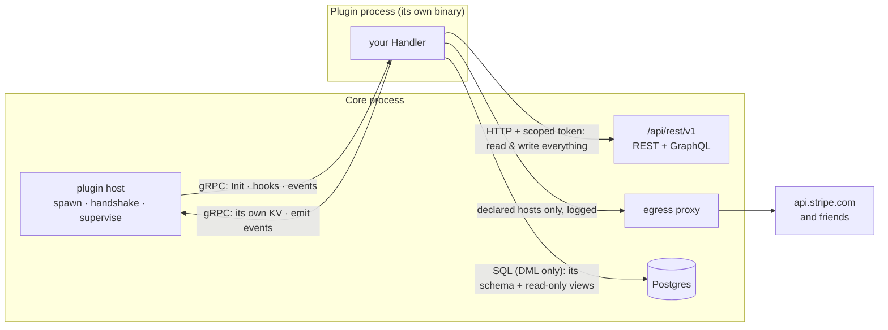

> **Not writing Go?** You do not have to. Nilda talks to plugins over gRPC, which is not a Go idea — see
> [ANY_LANGUAGE.md](ANY_LANGUAGE.md) for the whole contract: the handshake, AutoMTLS, the proto, and a
> working Python sketch. This guide is the Go SDK, which hides all of it.

# Nilda Plugin SDK

> The contract Core and every plugin share, and the surface a plugin author actually writes against.
>
> **Status:** built and shipping. Contract **v2** (`nilda.plugin.v2`, `ProtocolVersion = 2`).
>
> Every code example here is real: the types, methods and field names below exist in this module. The
> previous version of this document showed `nilda.ServeApp`, `core.Datastore.DB()`, `core.Routes.Mount()`
> and an `OnContentSaved` handler — none of which ever existed. Someone following it wrote code that did
> not compile. If you find a mismatch between this file and the code, the code is right and this file is a
> bug.

---

## 1. The shape of the system

A plugin is **its own binary, in its own process**. Core spawns it, and they speak gRPC over
`hashicorp/go-plugin`. One rule explains where everything lives:

> **gRPC is how Core calls the plugin. HTTP is how the plugin calls Core.**



Five doors, and each is capability-gated:

| Door | Transport | What it is for | Needs |
|---|---|---|---|
| Core → plugin | gRPC | `Init`, hooks, events (`Health` is defined and never called: a plugin is supervised by its process and its calls) | — |
| plugin → Core data | **HTTP** to `/api/rest/v1` | read *and write* content, media, taxonomy, menus | a write/read capability |
| plugin → Core state | gRPC | its own KV namespace, emitting events | `kv`, `events` |
| plugin → its tables (Core-owned) | SQL | real transactional data, joins against Core's published data | `datastore` |
| plugin → the internet | HTTP via Core's proxy | payment gateways, SMS, exchanges | a `network` declaration |

---

## 2. Writing a plugin

```go
package main

import (
	"context"

	nilda "github.com/nilda-dev/plugin-sdk"
)

type Shop struct{ core *nilda.Core }

func main() { nilda.Serve(&Shop{}) }

// Init runs once, after the handshake. Everything the plugin was granted arrives here.
func (s *Shop) Init(ctx context.Context, core *nilda.Core) (nilda.InitResult, error) {
	s.core = core
	return nilda.InitResult{
		Hooks: []string{"content.saved"}, // requires `hooks`
		// requires `events`. Nilda's own shop plugin emits this when an order is paid, and Core lets
		// only the plugin holding `commerce` use the `ecommerce.*` names, so no other plugin can fake one.
		Events: []string{"ecommerce.order_paid"},
		Schedules: []nilda.Schedule{ // requires `schedule`
			{Name: "reminders", Cron: "0 9 * * *"},
		},
		// RouteAddr: addr,                // requires `route` — see §5
	}, nil
}

func (s *Shop) HandleHook(ctx context.Context, hook string, payload []byte) ([]byte, error) {
	// Filter-style: return the payload, modified or not.
	return payload, nil
}

func (s *Shop) HandleEvent(ctx context.Context, eventType string, data []byte) error {
	return nil
}
```

`Handler` is those three methods. There is no `ServeApp` and no second plugin type — an "app" plugin is
just one that declared `route` and `datastore`.

---

## 3. Reading and writing Nilda's data

`core.API()` is an HTTP client already carrying this plugin's scoped token. It talks to the same surface
any external integration talks to, so there is one API to learn and one to maintain.

The base URL is Core's `/api/rest/v1` — the versioned contract of SPEC_73/74, and the only surface that
authenticates API tokens. The content type is part of the PATH.

**Failures worth branching on.** A 429 or a 5xx is retried for you with exponential backoff, honouring
`Retry-After` up to ten seconds a wait; a 4xx is not, because repeating it changes nothing.

**Your token is rate-limited like any API token.** Core allows `API_RATE_LIMIT_PER_TOKEN` requests in its
window — 1,000 an hour unless the operator set otherwise — and answers the next with 429 and a `Retry-After`
that can be most of the hour. The client will not wait that long inside your code: after its retries it returns
the 429, and the call has failed. Plan bulk work to fit (one `/batch` call carries 50 operations), and read
`APIError.RetryAfter` to schedule the rest yourself.

```go
var apiErr *nilda.APIError
if errors.As(err, &apiErr) {
    switch {
    case apiErr.Forbidden(): // the manifest is missing a capability — a backoff will not fix it
    case apiErr.NotFound():
    case apiErr.Conflict():
    case apiErr.RateLimited():
    }
    log.Print(apiErr.Code) // Core's own error code, rather than matching on a sentence
}
```

**Writing in bulk?** A `POST` or `PATCH` is never retried automatically, because it may have succeeded
before the response was lost and repeating it would create a second row. Give each unit of work its own
key and it becomes safe:

```go
for _, row := range rows {
    if err := api.WithIdempotencyKey(row.ID).Post(ctx, "/content/product", row, nil); err != nil {
        return err
    }
}
```

An importer interrupted at row 312 can then be run again from the start — within 24 hours — without
producing 312 duplicates. Core keeps the FIRST result for each key and hands it back to every repeat of the
same request (marked `Idempotent-Replayed: true`), errors included, so a retry after a 5xx cannot write
twice. The same key on a different request is refused (422); a repeat while the first is still running is
refused (409); a request Core refused (4xx) gives its key back, and so does a 503 — "nothing changed, ask
again" — so the same key runs again. Keys belong to your plugin's identity, not
its token, so they survive a restart — under the same scopes: a repeat made with different ones (an update
changed what your plugin may do) is a different request, refused 422, never handed the first answer.

`WithMaxRetries` tunes the patience — a hook runs inside Core's budgets, so less is sometimes right. Each
call Core makes to you has `PLUGIN_CALL_TIMEOUT` (5 seconds by default); every subscriber of one hook
shares ten seconds (an event is delivered to each subscriber on its own, a call each attempt); and everything one public page asks of plugins — its widgets and its footer
scripts together — shares 1.5 seconds, past which the page renders without the rest. Two calls get more:
`Init` has `PLUGIN_INIT_TIMEOUT` (30 seconds by default), because a one-time data step runs there, and a
payment gateway's four hooks (describe, start, refund, sync) have at most 15 seconds or `PLUGIN_CALL_TIMEOUT`, whichever is longer — less
when the request that asked has less left, since `payment.start` and `payment.describe` run inside it
(PAYMENTS.md).

```go
api := s.core.API()

// Create — this is what no plugin could do before contract v2.
// A single resource comes back wrapped in a `data` envelope (SPEC_74).
var created struct {
	Data struct {
		ID       string `json:"id"`
		AuthorID string `json:"author_id"` // this plugin's service account
	} `json:"data"`
}
err := api.Post(ctx, "/content/product", map[string]any{
	"title":  "Blue Widget",
	"status": "draft",
	"values": map[string]any{"sku": "BW-1"},
}, &created)

// Query, with real filters and keyset pagination.
var page struct{ Data []map[string]any `json:"data"` }
err = api.Get(ctx, "/content/product", url.Values{"status": {"published"}}, &page)

// Edit, publish, delete.
id := created.Data.ID
err = api.Patch(ctx, "/content/product/"+id, map[string]any{"title": "Blue Widget v2"}, nil)
err = api.Post(ctx, "/content/product/"+id+"/publish", nil, nil)
err = api.Delete(ctx, "/content/product/"+id)

// Many operations in one round trip — up to 50 a request (Core's API_BATCH_MAX), so an importer
// creates 500 products in ten.
err = api.Post(ctx, "/batch", batchOps, &batchResult)
```

Other resources: `/media`, `/media/:id`, `/users/:id`, `/taxonomies`, `/taxonomies/:key/terms`,
`/terms/:id`, `/menus`, `/site`. GraphQL is at Core's `/api/graphql`.

A file goes into the media library with `api.UploadMedia` (needs `media.write`) — `POST /media` takes a
multipart upload, not JSON, so `api.Post` cannot send one:

```go
var up struct{ Data struct{ ID string `json:"id"` } `json:"data"` }
err = api.UploadMedia(ctx, "kettle.jpg", file, "A copper kettle", &up)
```

**Check before you use it.** `core.API()` is `nil` when the manifest declared no capability that grants
API access (and `core.HasCapability("email")` answers the same question for any one capability — a mirror
of what Core enforces, never the enforcement):

```go
if !core.HasAPI() {
	return nilda.InitResult{}, fmt.Errorf("this plugin needs content.write — add it to the manifest")
}
```

A refusal comes back as `*nilda.APIError` carrying Core's own message, and `Forbidden()` marks the case
whose fix is a manifest change rather than a retry:

```go
var apiErr *nilda.APIError
if errors.As(err, &apiErr) && apiErr.Forbidden() {
	// the token lacks the scope — the manifest is missing a capability
}
```

### Real SQL, when HTTP is the wrong tool

**You declare your tables. Core creates them, and Core owns them.** The data is the site owner's, not
yours — so it outlives your plugin.

```json
"capabilities": ["datastore"],
"tables": [
  {
    "name": "orders",
    "columns": [
      {"name": "id",         "type": "uuid",        "primary_key": true, "default": "gen_random_uuid()"},
      {"name": "content_id", "type": "uuid",        "null": true},
      {"name": "qty",        "type": "int",         "default": "0"},
      {"name": "sku",        "type": "text",        "unique": true, "null": true},
      {"name": "created_at", "type": "timestamptz", "default": "now()"}
    ],
    "indexes": [{"columns": ["content_id"]}]
  }
]
```

Then query it, joined against read-only views over Core's **published** data, in one statement instead of
pulling every row over HTTP:

```sql
SELECT c.title, o.qty
FROM orders o                         -- your table, in your schema, created by Core
JOIN public.core_content c ON c.id = o.content_id
WHERE o.created_at > now() - interval '7 days'
```

**Your role has `SELECT`, `INSERT`, `UPDATE`, `DELETE` — and no DDL at all.** `CREATE TABLE` fails.
`DROP TABLE` fails. `ALTER` fails. Postgres refuses them; this is not a rule you are asked to respect.

Why it works this way: the schema used to be created `AUTHORIZATION <your role>`, which made it yours —
and so uninstalling a shop plugin ran `DROP SCHEMA CASCADE` and destroyed every order the shop had ever
taken. **Uninstalling a plugin must not delete the site's records.** Ownership was the bug.

What that means for you day to day:

- **Adding a column is additive and safe.** Declare it; the next enable adds it. Ship a `default` if you
  want `NOT NULL`, because a bare `NOT NULL` cannot be added to a populated table.
- **You cannot drop or retype a column, or move the primary key.** Nothing in the plugin path emits
  destructive DDL, and an update that marks a different column `primary_key` is refused before anything
  changes — as is switching on a reinstall over the tables an earlier install left (the install itself
  succeeds; its first enable is refused). Need a different shape? Declare a new
  table and move the rows with the DML you already have.
- **A new unique column or index must fit the rows already there.** An update whose new unique column or
  index would put two existing rows on one value — a new unique column whose `default` gives every row the
  same value, say — is refused before anything changes, naming the table.
- **The site keeps working while your tables change.** Core adds only the columns a table does not have
  yet, and builds an index `CONCURRENTLY`, after the table statements commit — so a new index on a
  populated table does not hold the site's writes to it while it builds.
- **Types are a fixed set**: `uuid`, `text`, `int`, `bigint`, `numeric`, `bool`, `timestamptz`, `date`,
  `jsonb`. Defaults are a fixed set too (`now()`, `gen_random_uuid()`, `'{}'::jsonb`, `true`, `0`, …) plus
  plain numbers and quoted strings. A declaration cannot express `DROP TABLE users`, which is the whole
  reason it is a declaration and not a `.sql` file you ship.
- **A default must fit its column**, by Postgres's own rule: a `text` column takes any default; `now()` fits
  `timestamptz` and `date`, `gen_random_uuid()` fits `uuid`, `true`/`false` fit `bool`, a plain number fits
  `int`, `bigint` and `numeric` within its range (below); a quoted string must be a value of the column's type (`'42'` on an `int`,
  `'yes'` on a `bool`). A quoted date or time is left to Postgres, which reads too many spellings of one to
  restate — a wrong one still fails when the table is built.
- **Limits**: at most 64 tables, 64 columns a table, 16 indexes a table and 32 columns an index (Postgres
  builds no wider). The 16 counts every index Core builds on the table — its unique columns, and the one a
  list page's `order_by` adds, as well as the ones you list. No column may take the name of a column Postgres
  keeps on every table (`tableoid`, `xmin`, `cmin`, `xmax`, `cmax`, `ctid`), and no table the name Postgres
  gives another's primary key (`orders_pkey` beside `orders`). A plain-number default must fit its column —
  `int` holds −2,147,483,648 to 2,147,483,647, rounded first — because Postgres builds the table either way
  and refuses every row that takes the default.
- **Index names are Core's**: `<table>_<columns>_idx` (`_uniq` for a unique one), so `gateway` indexing
  `txn_ref` and `gateway_txn` indexing `ref` would share a name, and so would an index and a table called
  what it would be called. Either is refused, naming both declarations — one of the two would otherwise
  never be built.
- **`nilda plugin check` validates the declaration locally** — types, defaults, limits, names — naming the
  exact table and column. The two rules that depend on what a site already holds — moving the primary key,
  and a new unique column or index the existing rows cannot take — need that site's tables, so they are
  checked when the update is applied there, before anything changes.

### Your own content types and taxonomies

A shop's products, a booking plugin's services and their categories are **Core content**, not rows in your
tables: they get an archive page, a slug, SEO and a sitemap entry for free, and they outlive your plugin.
Declare them, and Core creates them on every enable — additively, never deleting or retyping a field:

```json
"capabilities": ["content.write", "taxonomy.write"],
"content_types": [{"key": "shop_product", "label": "Products", "fields": [
  {"key": "price", "label": "Price", "type": "number"}
]}],
"taxonomies": [{"key": "shop_category", "label": "Categories", "hierarchical": true,
  "applies_to": ["shop_product"]}]
```

- **Namespaced by your plugin's key.** Every key starts with `<key>_`. A content type key is at most 40
  characters — the content-type registry's own bound — and a taxonomy key at most 60.
- **Bounded**: at most 8 content types of at most 48 fields each, and 8 taxonomies, each attached to between
  1 and 32 content types (`applies_to` is required: a taxonomy attached to nothing is a tree nobody can use).
- **Owned by whoever created it.** A second plugin declaring a key you created is refused by name — and so
  is it after you are uninstalled, because the type and its items stay with the site: the refusal says to
  reinstall you, or to delete the type first. Where two plugins' keys overlap (`shop` and `shop_widgets`), a
  key under both belongs to the longer: `shop_widgets_gadget` is `shop_widgets`'s, whoever installed first.

Views, not tables, on Core's side: `core_content`, `core_users`, `core_media`, `core_terms`,
`core_content_terms`. They carry published rows and public columns only — a view cannot apply per-viewer
visibility, so anything whose answer depends on *who is asking* goes through the API, which enforces it
properly. `core_content` also leaves out what the site hides from everyone — embargoed items and items past
their expiry — and has an `unlisted` column: an unlisted item is readable by its link, so it is there for your
joins, but leave it out of anything you list, as the site's own lists do. Your role cannot read Core's tables
and cannot reach another plugin's schema.

### What happens when a site owner removes your plugin

| | |
|---|---|
| Your process | stopped |
| Your login role | dropped — nothing can connect |
| Your tables and every row | **kept**, owned by Core |
| Your KV namespace | purged (no schema, no export path, nothing an operator could inspect) |
| Content you created in Core | kept, still attributed to your plugin |

The owner sees retained data listed with its real size and can delete it deliberately, by retyping the
plugin key. Reinstalling finds the tables still there.

---

## 4. Capabilities

Declared in the manifest, approved by the site owner at install, enforced by Core on every call.

| Capability | Grants |
|---|---|
| `content.read` / `content.write` | read / create, edit, publish, delete content of any type |
| `media.read` / `media.write` | read / upload and delete media |
| `taxonomy.read` / `taxonomy.write` | read / manage terms |
| `menus.read` / `menus.write` | read / edit navigation |
| `users.read` | read user identity |
| `hooks` | receive hook callbacks |
| `events` | subscribe to events, and emit your own — see below for which names are yours |
| `datastore` | a dedicated Postgres schema, tables Core creates from your declaration, DML-only access |
| `kv` | a scoped key-value namespace for small state: a value is at most 64 KiB (a larger one answers `InvalidArgument`), and on every install one plugin holds at most 10,000 keys and 16 MiB (in Core's memory on a Lite install, beside Core's cache on Dragonfly, where writes racing each other at the very edge can pass it together) — a write past that answers `ResourceExhausted`, after expired keys are cleared, with no `google.rpc.RetryInfo` (a call past the kv rate limit carries one; waiting does not empty a full namespace); declare `datastore` for more |
| `route` | a reverse-proxied URL prefix |
| `secrets` | keep your own secrets with Core — a sign-in token for a service the owner connects — encrypted, and still there after a restart; see "Keeping a secret" |
| `render.assets` | load its own scripts on public pages — see §4.1 |
| `widget` | contribute page-builder widgets — see §4.1 |
| `email` | send mail through the site's mailer (Core fixes the sender) |
| `schedule` | ask Core to run recurring work and call back |
| `abilities` | offer your actions to the site's AI agent — see §4.2 |
| `admin_page` | your own section of the admin sidebar: settings forms and list pages — see §5 |
| `field` | contribute a kind of field to content types and forms — see "Contributing a field type" |
| `auth_provider` | put a sign-in button on the login page — see §5 |
| `search_provider` | be the site's search engine — see §5 |
| `commerce` | be the site's shop: supply the products, prices and cart the storefront widgets draw — see §5 |
| `payment_gateway` | be one payment processor for the site — Stripe, PayPal, a bank — see "Taking payments" (Core from the release built on SDK v0.10.0) |
| `payment_session` | take payments through the site's gateways: an order, a deposit, a donation — see "Taking payments" (the same release) |
| `service_provider` | answer other plugins through Core's service desk, in the contracts the manifest `provides` — see "Answering and asking other plugins" (Core from the release built on SDK v0.14.0) |
| `service_consumer` | ask other plugins through Core's service desk, in the contracts the manifest `requires` or `uses` (the same release) |
| `visitor_tools` | let visitors' own AI agents read and submit through your public actions — see "What a visitor's own AI agent may do" (Core from the release built on SDK v0.18.0) |
| `site_files` | answer at `/agents.md` or `/.well-known/<name>` at the site's root — see "Files at the site's root" (the same release) |

That is the whole list. Every entry is dispatched by Core and has a surface in this SDK; there is nothing
to declare that does nothing. `admin.pages` and `payments` used to appear here and were removed in v0.3.0
— neither was ever implemented in Core, so a plugin could be granted them and receive nothing. Declaring
either one now fails validation.

**Payments are a Core contract, and every gateway is its own plugin** (Nilda's D-84, 2026-09-23). A gateway
declares `payment_gateway`; whatever takes the money declares `payment_session` and talks only to Core, which
owns every payment and sends it to the gateway the payer chose. Plugins never call each other. The two
capabilities arrive with plugin-sdk v0.10.0 and the Core release built on it — an older Core refuses a
manifest that declares either. To take one payment from one page with no plugin at all — an ebook, a
donation — the site owner drops a PayPal button widget in the page builder (Core's Stripe button was retired on
2026-10-10; a card payment goes through a gateway plugin). The names `payment`
and `payments` stay refused, so the retired meaning cannot come back by accident.

A write capability applies to **every** content type, not a declared subset. What keeps that honest is
attribution, not narrowing: a plugin acts as its own visible service account, so everything it creates or
edits is recorded as its work.

**An event you emit is named for you.** `events` lets a plugin emit, and Core checks the NAME: yours start
with your key — `shop` emits `shop.order_paid`, which `core.PluginKey + ".order_paid"` builds — or with a
namespace a capability you hold owns: `commerce.*` and `ecommerce.*` belong to the site's shop, the plugin
holding `commerce`, whoever wrote it (`ecommerce.*` is the spelling Nilda's own shop plugin shipped its
order events under). A name with no namespace — no dot, or nothing on one side of it (`.paid`, `shop.`) — is refused with `InvalidArgument`; any
other name that is not yours with `PermissionDenied`, and Core's own names (`content.*`, `form.*`,
`comment.*`, …) are refused to every plugin, even one keyed `content`. The reason is the subscriber: a
plugin listening for an order event has nothing but the name to tell it who sent it, so a name anyone
could use would let one plugin announce an order nobody paid. `nildatest` refuses the same names — all but
Core's own, which it cannot know — so a wrong one fails your tests first.

**An event is kept until it is delivered.** `Emit` returns once Core has stored the event for every
subscriber, before any has run. Core delivers it to each one separately and, when one cannot take it — it is
restarting, it timed out, its `HandleEvent` returned an error — tries again for about three days, then tells
the site's admins, whose assistant can send it again once the plugin works. So **return an error from
`HandleEvent` only to mean "not now"**, and return nil for an event you have handled or choose to ignore.
Every attempt carries the same id (`nilda.EventOf(ctx).ID`): an id you have seen is a repeat to drop.

**Events are not ordered.** A retried event can arrive after one emitted later, so two events emitted a
moment apart can reach a subscriber the other way round. Carry what a subscriber needs to decide in the event
itself — a status, a version — rather than relying on which arrived last.

### 4.1 Putting something on a public page

Two capabilities let a plugin reach a page a visitor loads. Both have typed interfaces — implement one and
you never see a hook name or a byte slice.

**`widget` — page-builder widgets.** Implement `nilda.WidgetProvider`:

```go
func (s *Shop) Widgets() []nilda.WidgetDef {
	return []nilda.WidgetDef{{
		Type:  "product-grid", // Core namespaces it as "<your key>.product-grid"
		Label: "Product grid",
		Fields: []nilda.WidgetField{
			{Key: "count", Label: "How many", Type: nilda.FieldNumber, Required: true},
		},
	}}
}

func (s *Shop) RenderWidget(ctx context.Context, req nilda.WidgetRenderRequest) (string, error) {
	return "<ul>…</ul>", nil
}
```

`RenderWidget`'s output is **sanitized** by Core with its component policy: `<script>`, `<iframe>`, `on*`
handlers, `javascript:` URLs and the `style` attribute are removed; `class` and `data-*` are **kept**, so the
theme can style your markup and your script can find it. Anything that runs belongs in a script served from
your own route, not in this string.
Note what `WidgetRenderRequest` does *not* carry — no user, no session. Rendered pages are cached, so a
widget that varied by viewer would serve one visitor's output to the next.

**`render.assets` — your own script on every page.** Implement `nilda.AssetProvider`:

```go
func (s *Shop) FooterScripts(ctx context.Context, req nilda.RenderAssetsRequest) []nilda.ScriptAsset {
	if req.PageKind == "notfound" {
		return nil
	}
	return []nilda.ScriptAsset{{Src: "/shop/cart.js", Defer: true}}
}
```

A **path**, never markup — Core builds the `<script>` tag itself. `Src` must be root-relative,
same-origin, and under your own declared route prefix, so this capability needs `route` as well — Core
refuses a manifest that declares `render.assets` without it, because a plugin that serves no paths owns
none. An absolute URL or someone else's prefix is dropped — the page renders without it, and Core's log
names the path it rejected.

Core delivers only a hook a plugin subscribed to, for these two as for every other. You do not list them in
`InitResult`, because `Serve` does it for you: implementing `AssetProvider` subscribes `render.assets`, and
implementing `WidgetProvider` subscribes `widget.describe` and `widget.render`. A plugin that handles the
widget hooks by hand in `HandleHook`, without implementing `WidgetProvider`, has to list them itself.

Core's limits, published as `nilda.MaxWidgetsPerPlugin` (20), `nilda.MaxWidgetHTMLBytes` (64 KiB) and
`nilda.MaxAssetsPerPlugin` (5). Past a count, the excess is dropped and logged on Core's side.

What one `widget.describe` answer — your `Widgets()` list — may carry is bounded too: 1 MiB for the whole answer, and in one widget
at most 200 fields — counted at every level, a repeater's sub-fields included — with at most 200 choices and
50 rows in any one field. A widget past a bound is not offered at all (logged on Core's side, like the rest),
and an answer past 1 MiB offers none.

A render over `MaxWidgetHTMLBytes` is treated like an error from `RenderWidget`: nothing on a visitor's page,
and on the editor's canvas a box saying the widget could not be shown, so an author is not sent to fill in
settings that were never the problem.

---

## 5. Manifest

```json
{
  "key": "shop",
  "name": "Shop",
  "version": "1.0.0",
  "sdk_version": "0.3.0",
  "nilda_compat": ">=0.1.0",
  "capabilities": ["content.write", "media.write", "datastore", "route", "hooks"],
  "route_prefix": "/shop",
  "network": ["api.stripe.com", "*.twilio.com"]
}
```

No `os` or `arch` in a Go plugin's manifest — see §5.1 for why.

**There is no `signature` field.** It used to live here, over the binary alone — which meant the signature
did not cover the manifest, and the manifest is the thing a site owner approves. A package could have
`content.write` and `network: ["evil.example"]` added in transit and still verify. The signature now lives
in a separate file BESIDE the package, over the package's own bytes — and the manifest is inside those
bytes, so it is covered. See §5.1.

An unknown field is REFUSED by `nilda plugin check`: `"capabilties"` is a typo you want to hear about at
your keyboard, not a plugin that installs with no capabilities and fails at runtime for reasons nobody
traces back to a spelling. An INSTALL tolerates one, so a package built for a newer Nilda still installs on
an older one with what that version understands — and the owner is told which fields were ignored, by path
at any depth (`tables[].columns[].collation`), beside the install's success.

`version` is semver without leading zeros: `1.09.0` is refused, because it would compare equal to `1.9.0`
and an update to either could be turned away as not newer. An update must be strictly newer than what is
installed.

### 5.1 The package

`nilda plugin build` writes one archive per platform, `dist/<key>_<os>_<arch>.nplug`, holding exactly two
entries — Core's installer refuses any other:

```
plugin.json     your manifest, byte for byte as you wrote it
bin/plugin      the executable
```

When you build with `--sign-key`, the publisher signature is written BESIDE the archive as
`dist/<key>_<os>_<arch>.nplug.sig`, over the archive file's own bytes. Editing the manifest, swapping the
binary or renaming an entry changes those bytes, so all of them break it — and neither side needs a digest
scheme the other must reproduce. A `signature` entry INSIDE the archive is refused at install: a signature
cannot cover the file that contains it.

```sh
nilda plugin build . --sign-key ./signing.key     # a file holding the base64 Ed25519 private key
```

`--sign-key` names a FILE holding the key, base64, rather than taking the key as a flag value, because a
private key passed on the command line lands in your shell history and in the process list. The
alternative is `NILDA_SIGN_KEY`, which holds the base64 key ITSELF, not a path to it (the file wins when
both are set). Without either, `build` writes unsigned packages and says so. Unsigned packages are fine
locally AND for the marketplace: `publish` uploads only the `.nplug`, and Central signs what its reviewer
approves — over the listing, the version and the bytes — so an install trusts the marketplace's signature,
not yours. Your signature matters to a site that installs your file by UPLOAD under a signed-uploads policy.

**Leave `os` and `arch` out of a Go plugin's manifest.** Core reads the platform out of the binary's own
build information and refuses, at install, a binary built for another platform than the server's, with a
message naming both — instead of letting it fail later as an exec error about a bad executable format. A
DECLARED platform is checked against the binary as well, and a mismatch is refused as a package that
describes something other than what would run. `nilda plugin build` copies one manifest into every
platform's package, so a manifest declaring `"os": "linux", "arch": "amd64"` makes the darwin and arm64
packages uninstallable. The two fields matter only for a binary with no Go build information — a plugin in
another language (ANY_LANGUAGE.md); a Go binary built with `-ldflags='-s -w'` keeps it, since stripping removes
symbols and debug data, not the build information: a site in sideload mode then falls back to what
the manifest declares, and the marketplace refuses the package, because it cannot tell what it would be
distributing.

`network` is the list of external hosts the plugin may reach — at most 32. The owner reads it at install
beside the capabilities — and on the plugin's row afterwards — and Core routes outbound traffic through a
proxy that enforces it and writes every attempt to the server's log. A wildcard covers one level (`*.twilio.com`
matches `api.twilio.com`, not `a.b.twilio.com`); a bare `*` is refused, and so is a wildcard over a public
suffix — `*.com`, `*.co.uk`, `*.github.io` — because those reach every site anybody registers there. Core's
own API is always reachable and never declared.

**Any client that honours `HTTPS_PROXY` is identified**: the proxy address Core hands your process carries
your plugin's key, so a bare `http.Client{}`, a wrapped transport or a plugin in another language is known
to the proxy by it. The SDK's client is the one already set up for it:

```go
client := nilda.HTTPClient(30 * time.Second)  // carries the plugin's identity
res, err := client.Get("https://api.stripe.com/v1/charges")
```

**Connections are bounded.** A plugin holds at most 64 connections through the proxy at once — the next one
is refused with a 503 rather than queued — and a tunnel nothing crosses, in either direction, for 10 minutes
is closed. A pooled client stays far inside both; a plugin that opens a connection per request and never
closes it does not.

### What you do with personal data (`processing`)

A site's privacy notice must say what is done with a visitor's data, who receives it and how long it is kept (GDPR
Art. 13). Core knows its own and names a payment gateway's processor and a carrier plugin's carrier; for anything else
your plugin does, say it in `plugin.json` (Core from the release after SDK v0.23.0):

```json
"processing": [
  { "what": "a shopper's email address and the sentence they agreed to, to email them once when an item is back",
    "recipient": "this site only", "retention": "30 days after the email was sent or the request stopped" }
]
```

`what` and `recipient` are required — `recipient` is "this site only" or the outside party by name — and `retention`
says how long or by what rule; at most 16 entries, a sentence each. The owner reads them at install and on the plugin's
row, and while the plugin is active every entry is a row of the site's privacy record (`legal_requirements`,
`legal_notice`), in your words. Core cannot check them: write what the code does.

### Telling the site's owner (`notifications`)

Your events reach other plugins (`events`); the owner hears of them only if you say which. Declare them in plugin.json,
and Core turns each one you emit into a notice: the panel's bell, the Nilda app's Activity, and a push for the kinds an
owner acts on at once. Core writes the words from your declaration — never from your process — in the reader's language:

```json
"notifications": [
  {"event": "ecommerce.order_placed", "kind": "order", "title": "New order {ref} · {total}",
   "page": "orders", "row": "order_id"}
],
"translations": {"de": {"New order {ref} · {total}": "Neue Bestellung {ref} · {total}"}}
```

- `event` is a name you may emit (your key's namespace, or a capability's); `events` is required.
- `kind` is `order`, `booking` or `payment` (a push unless the owner turns it off), or `message`, `comment`, `stock`,
  `subscriber`, `other` (no push until the owner turns it on). It is also the app's filter.
- `title` (120 characters) and `body` (200) are English with `{field}` taken from the event's data — a string, number
  or yes/no; translate them in `translations`, keyed by this English text, like every label.
- `page` is one of your list pages, `row` the event field holding the row's id there, and `action` one of that page's
  row actions, offered as the one tap in Activity.

Who hears: the people who may act on your plugin (its admin section's permission and `plugin.manage`). A notice keeps
only the values its words name, without control or direction characters, and the lock screen says only the kind and
your plugin's name ("New order — From Shop"): a customer's name or address never reaches it. At most 30 notices a
minute; past that your event still reaches its subscribers.

### "/" commands in the content editor (`editor_commands`)

A plugin can add entries to the content editor's "/" menu. Like tables, they are DECLARED — there is no
code to ship into the editor, and no capability to ask for:

```json
"editor_commands": [{
  "key": "product_card", "label": "Product card", "group": "Shop", "keywords": ["product", "buy"],
  "content": {"nodes": [{"type": "paragraph"}]}
}]
```

`content` is what the command inserts: serialized editor nodes, the shape the editor's own clipboard uses.
`group`, `icon` and `keywords` are optional; the key is namespaced with your plugin's key, so two plugins
can both declare `callout`. Core refuses at install more than 24 commands, a `key` that is not a lowercase
identifier or is declared twice, an empty `label` or one longer than 120 characters (a `group`, an `icon`
and each keyword too), more than 16 keywords, and a `content` that is
empty or not JSON — it does not check the nodes themselves, so try a command on a test site before you ship
it. Only an active plugin's commands are in the menu: disable the plugin and they go with it.

### Recurring work (`schedule`)

Return schedules from `Init` and Core calls back through `HandleHook`:

```go
func (s *Shop) HandleHook(ctx context.Context, hook string, payload []byte) ([]byte, error) {
	if hook == nilda.ScheduleHook("reminders") {
		return payload, s.sendReminders(ctx)
	}
	return payload, nil
}
```

Your process is resident, so you *could* run your own ticker — but a Core-owned schedule is visible to the
site owner, survives a restart, does not double-fire when the plugin is relaunched, and is torn down by an
uninstall. A timer inside your process is none of those things.

A schedule that hangs fails its call and counts toward the same failure budget as a slow content hook.

### Telling the AI agent what you can do (`abilities`)

A hook is the site calling you. An **ability** is the reverse: you telling the site's AI agent that an
action exists, so that when the owner types "add these fifty products" the model has something to call.

Without one, the only actions in the world are the ones Core itself ships. Your plugin can know perfectly
well how to register a product; the agent cannot see that the action exists.

```go
func (s *Shop) Init(ctx context.Context, core *nilda.Core) (nilda.InitResult, error) {
	return nilda.InitResult{
		Abilities: []nilda.Ability{{
			Name:        "create_product",
			Label:       "Create a product",
			Description: "Add a product to the shop. Use when the owner asks to list something for sale.",
			Class:       nilda.ClassWrite,
			InputSchema: nilda.ObjectSchema(map[string]any{
				"title": map[string]any{"type": "string", "description": "The product name."},
				"price": map[string]any{"type": "number"},
			}, "title", "price"),
			Run: s.createProduct,
		}},
	}, nil
}
```

Core turns that into an agent tool named `shop.create_product` — namespaced under your plugin key, so two
plugins can both offer `create_product` without colliding.

**Write the description for the model, not for a colleague.** It is the only thing the agent reads when
deciding whether yours is the right tool for what the owner asked. "Adds a product" is a tool that never
gets called; the version above says *when* to use it.

**Describe, never sell.** The marketplace review refuses a description that ranks your plugin, steers the
assistant toward it ("always use this", "instead of other plugins"), upsells ("upgrade to Pro"), or carries a
link. The assistant chooses tools for the owner, not for you.

**Declare them in `plugin.json` too — the SDK writes the list.** The review reads your package and never runs it,
so each ability's `name`, `label`, `description` and `class` is also written in the manifest's `abilities`, and a
Core built on v0.11.0 offers the assistant only an ability declared there exactly as `Init` returns it. One that is
missing or whose words differ is not offered, and the plugin's start line names it. Do not type the list:

```go
func TestPluginJSONDeclaresTheAbilities(t *testing.T) {
	nildatest.ManifestAbilities(t, "plugin.json", (&Shop{}).abilities())
}
```

Run it once with `NILDA_WRITE_MANIFEST=1 go test -run PluginJSON .` and it writes the list into `plugin.json`,
leaving the rest of the file as it was; from then on it fails whenever `Init` and the manifest disagree.

**Say what you changed, row by row (`nilda.AbilityChange`).** An ability that changes something may answer, beside
its own result, a field `changes` — each row a `Label`, the `Before` and the `After`, plain text — and Core shows the
rows under the assistant's answer in the Nilda app and the panel: "Price €12.00 → €13.00". The model still reads your
whole answer. At most ten rows, a row with no label is dropped, `Before` empty for something new:

```go
return struct {
	Product string                `json:"product"`
	Changes []nilda.AbilityChange `json:"changes"`
}{id, []nilda.AbilityChange{{Label: "Price", Before: "€12.00", After: "€13.00"}}}, nil
```

**An ability that changes the site asks the person first.** `write` and every class above it take Core's own two
steps: the first call answers with a preview — your plugin's name, the ability's label and the arguments — and runs
nothing; the person's yes runs exactly the arguments they saw. Your plugin is called once, after the yes, and never
sees the confirmation token. `read`, `analyze` and `additive` run on the first call.

**Declare the truest `Class`, not the most convenient one.** The class is what Core's guardrails run on:
each connector has a risk ceiling the owner sets, and an ability above it is refused before your plugin is
ever reached. A lower class does not make your action safer — it makes it reachable by connectors the
owner meant to keep on a short leash. A class Core does not recognise is treated as the *most* restricted
one, so a typo costs an owner one permission click rather than an unguarded action.

| Class | For |
|---|---|
| `read` | returns information, changes nothing |
| `analyze` | audits the owner's own site — grades it, lists its problems; changes nothing |
| `additive` | produces a draft or suggestion; nothing goes live |
| `write` | edits live data |
| `publish` | makes something public, or takes it down |
| `structural` | changes the shape of the data model |
| `destructive` | deletes, or acts in bulk |
| `access` | roles, permissions, credentials |
| `infra` | maintenance, caches, backups, the install itself |

**On a hosted site without the AI-execution plan, the site's assistant runs only `read` abilities.** Every class
above `read` — `analyze` included, since an audit costs a model call — is what that plan sells the assistant doing, and
is refused there before your plugin is reached. A self-hosted install brings its own AI key and client, so there every
class runs (Core's D-96). So `read` versus `analyze` decides whether your ability runs on a hosted site without the plan:
declare `read` only when that is the truth.

**Who may run it is Core's decision, not yours.** The class says how risky the action is; it does not say
which *person* may ask for it. Core runs an ability only for someone who holds `plugin.manage`, or
`plugin.<key>.configure` — the per-plugin permission your own admin section (`admin_page`) is gated on. An
Editor who holds `content.edit` and nothing of yours is refused, and the site's chat does not offer them the
action at all. You declare nothing for this: it is the same list your admin screens use, so a button your
screen refuses someone is an action the chat refuses them too. What you are NOT told is who that person was:
the call carries the hook's name, its input and what `nilda.CallOf(ctx)` reads — the request's id, and for a
call relayed by Core's service desk the contract, the asking plugin and an idempotency key — and nothing about
the person (a limit Core records in its known issues).

`InputSchema` is required and must be a JSON Schema **object** — an agent that cannot see the shape of
your input will call you with the wrong thing. `ObjectSchema` builds one so you do not hand-write JSON.

Set `Run` and the SDK dispatches for you. Leave it nil and the call arrives at your `HandleHook` under
`nilda.AbilityHook("create_product")`; `ability:` is a reserved hook namespace either way.

`abilities` is its **own** capability, separate from `hooks`. Receiving a callback when content changes and
letting a model decide to run one of your actions with no human in the loop are different powers, and the
owner granting the second should be agreeing to exactly that. It appears on their consent screen as
"Offer its actions to an AI agent, which can then run them on your behalf".

### What a visitor's own AI agent may do (`visitor_tools`)

An ability acts for the site's OWNER. A visitor tool acts for whoever is looking at the page — an anonymous
stranger, or the assistant that stranger pointed at the site: "find me a linen shirt in M under €60 here".

```go
return nilda.InitResult{VisitorTools: []nilda.VisitorTool{{
	Name:        "search_products",
	Description: "Search this shop's products by words; each comes with its price, sizes and page.",
	Effect:      nilda.VisitorRead,
	InputSchema: nilda.ObjectSchema(map[string]any{"query": map[string]any{"type": "string"}}, "query"),
	Paths:       []string{"/shop"},
	Run:         s.searchForAVisitor, // func(ctx context.Context, call nilda.VisitorCall) (any, error)
}}}, nil
```

Core publishes each one beside its own public tools — in the page through WebMCP (`navigator.modelContext`),
and on the site's public MCP endpoint for an agent with no browser — as `<plugin-key>.<name>`, under the same
owner switch for the whole surface and the same per-address rate limit. `Paths` are the prefixes it is offered
on (`/shop` covers `/shop/product/mug`); empty is every page.

**Two effects, and no third.** `Effect` is a `nilda.VisitorEffect`: `nilda.VisitorRead` answers from what the public pages show; `nilda.VisitorSubmit`
hands the site what a form on the page would. There is no write, publish or delete for an anonymous caller,
because a visitor has none. Core cannot see inside `Run`, so keeping that ceiling is yours, and the way to keep
it is reuse: call the code your public route calls, behind the same checks, and return what that page would
show.

`Run` gets a `nilda.VisitorCall` — the arguments, the page path, the caller's address and agent string — and
no identity, on purpose: the tool acts for nobody, and one that answered a signed-in caller differently would
grow a private surface on a public endpoint. The address is for your anti-abuse checks, never to vary the
answer. Leave `Run` nil and the call reaches `HandleHook` under `nilda.VisitorToolHook(name)`, the
`VisitorCall` JSON as its payload.

Requires the `visitor_tools` capability, and each tool declared in `plugin.json`'s `"visitor_tools"` (name,
description, effect, paths) exactly as Init returns it — Core offers only those. Do not type the list:
`nildatest.ManifestVisitorTools(t, "plugin.json", tools)` holds it and writes it with
`NILDA_WRITE_MANIFEST=1`. The owner's consent screen shows "Let visitors' own AI agents use its public
actions — search, look up, or send what its public forms send".

### Files at the site's root (`site_files`)

Some standards put a file at the origin's root, where no plugin prefix reaches: a protocol's discovery
document (`/.well-known/ucp`, `/.well-known/acp.json`) or an agents' guide (`/agents.md`). Declare the ones you
answer:

```json
"capabilities": ["route", "site_files"],
"site_files": ["/.well-known/ucp", "/agents.md"]
```

Core sends a GET or HEAD for exactly those paths to your resident server, at the same path — register them on
your own mux beside your prefix — and nothing else: another method is refused, and the request carries no
identity, as a `webhook_paths` call does not. A file is `/agents.md` or `/.well-known/<name>`; Core keeps the
names it answers itself or that guard the site (`mcp`, `oauth-*`, `openid-configuration`, `acme-challenge`,
`security.txt`, `change-password`, the app-link files, `http-message-signatures-directory`), and two plugins cannot hold one file — the second
install is refused and says which plugin has it. Requires `route`. The consent screen shows "Answer at these
addresses at the root of your site", with the list.

### Sending mail (`email`)

```go
err := core.SendEmail(ctx, buyer.Email, "Your order", body)
```

The recipient and the words are yours; the SENDER is Core's. That is deliberate — a plugin can address mail
but never forge who it is from — and it means you need no SMTP credentials of your own, and the owner
configures mail once for the site rather than again for every plugin.

When you know the recipient's language, say it: `core.SendLocalizedEmail(ctx, to, subject, body, "fa")` sends
the same mail marked with that language and its direction (`lang`, `dir`) — right to left for Persian or
Arabic, the way Core marks its own mail — where `SendEmail` sends it with no direction at all, which a mail
client shows left to right. An empty language is `SendEmail`.

**Receipts are not newsletters.** `SendEmail` and `SendLocalizedEmail` send MARKETING mail: it carries the site's
unsubscribe link and is withheld from anybody who used it. A message the recipient needs because of something
they did — an order confirmation, a payment receipt, a download link, a return — is
`core.SendTransactionalEmail(ctx, to, subject, text, html, lang)`: the urgent lane, no unsubscribe footer, and
delivered to a recipient who unsubscribed from marketing too (a buyer who left a newsletter still gets the receipt
for what they bought; only a hard bounce or a complaint stops it). `html` is an optional HTML part beside the text:
Core keeps paragraphs, headings, lists, links, images and emphasis and drops everything else, so you can show a
picture — an image the law asks you to show, a product photo — but never run anything. Never send a newsletter or a
reminder this way.

### Serving your own pages (`route`)

```go
func (s *Shop) Init(ctx context.Context, core *nilda.Core) (nilda.InitResult, error) {
	addr, err := nilda.StartHTTP(s.router())  // your own http.Handler
	if err != nil {
		return nilda.InitResult{}, err
	}
	return nilda.InitResult{RouteAddr: addr}, nil
}
```

Core reverse-proxies `/shop/*` to it, so a storefront serves itself without a round trip through Core per
request. `route_prefix` is one root segment, and Core refuses one it answers on itself — `/api`, `/admin`,
`/feed`, `/themes`, `/privacy`, `/category` and the rest — and any language's code (`/fa`, `/en`, `/pt`),
because a site serves each language it is published in under its code; `nilda plugin check` names it. The
code is the WHOLE prefix, as the site matches it: `/my-account` or `/to-do` is yours, though `my` and `to`
are languages.

**Who is asking.** `nilda.CurrentUser(r)` reads the person behind a request your server received — a
`nilda.Viewer` with their Core user id and display name, and `ok == false` for an anonymous visitor, which is
most storefront traffic and not an error:

```go
func (s *Shop) orders(w http.ResponseWriter, r *http.Request) {
	viewer, ok := nilda.CurrentUser(r)
	if !ok {
		http.Error(w, "sign in to see your orders", http.StatusUnauthorized)
		return
	}
	// viewer.UserID is a Core user id — key your per-customer rows to it.
	s.writeOrders(w, viewer.UserID)
}
```

Core's proxy is the only way traffic reaches your server, and it strips every inbound `X-Nilda-*` header
before setting its own, so a visitor cannot claim to be somebody by sending one. What you get is an id and a
name — never a token or a session you could replay against Core. On a `webhook_paths` endpoint you get
nothing, always: a machine's call carries no one's identity, which is what makes exempting it from CSRF safe.

### Where a visitor is, the EU's VAT rates and the seller (`VisitorCountry`, `Reference`)

**The visitor's country.** `nilda.VisitorCountry(r)` reads the country Core placed a request in from its internet
address — ISO 3166-1 alpha-2, the country and never the address, with any client-sent value stripped. It is one item of
the evidence EU VAT law accepts for where a buyer of a digital service is (Regulation 282/2011 Art. 24f(b)); keep it
with the sale.

**A key to limit by.** `nilda.VisitorKey(r)` (from v0.23.0) is an opaque key for the request's internet address — a
keyed hash Core makes of the whole IPv4 address or an IPv6 address's /64, changing every UTC day, never the address.
Limit a public write by it (a form that mails whoever it is given); it identifies nobody. "" from an older Core.

**The EU's VAT rates.** `core.API().Reference().EUVATRates(ctx, day)` returns an `EUVATRateSet`: every member state's
rates applying on that day (Brussels time), each an `EUVATRate` in basis points, read by Nilda Central from the European
Commission's Taxes in Europe Database and kept by Core through an outage. `set.Standard("FR")` is a member state's
nationwide standard rate; `set.Reduced("AT", "FOODSTUFFS")` its reduced rates for a TEDB category. No capability is
needed — it is public reference data — but the Commission's database is not the legal reference (the Official Journal
is), so a shop shows the set's `Source` and `CheckedAt` where a rate decides a price.

**The seller.** `core.API().Reference().Seller(ctx)` returns a `Seller`: who sells on the site — name, legal form,
register, VAT ID, contact and address — read from its imprint, the supplier an invoice must name (Directive 2006/112/EC
Art. 226(5)). Read it when the invoice is made and do not keep a copy, so an invoice and the published imprint never
disagree; a field the owner left empty is "", and a shop says what is missing rather than invoicing without it.

### Your own section of the admin (`admin_page`)

Declare it in `plugin.json`:

```json
{
  "capabilities": ["admin_page", "events"],
  "admin_pages": [{
    "key": "settings",
    "label": "Settings",
    "kind": "settings",
    "help": "Connect your Kavenegar account so the site can send SMS.",
    "fields": [
      { "key": "api_key",  "label": "API key",  "type": "text", "secret": true, "required": true,
        "help": "Find this under Account \u2192 API in your Kavenegar panel." },
      { "key": "sender",   "label": "Sender number", "type": "text" },
      { "key": "per_page", "label": "Messages per batch", "type": "number", "default": 50 }
    ]
  }]
}
```

The site owner gets a row in the sidebar named after your plugin, with `Settings` inside it. You read what
they typed:

```go
func (p *SMS) Init(ctx context.Context, core *nilda.Core) (nilda.InitResult, error) {
	if !core.HasSetting("api_key") {
		core.Log().Info("no Kavenegar key configured yet; not sending anything")
		return nilda.InitResult{}, nil
	}
	p.client = kavenegar.New(core.Setting("api_key"), core.Setting("sender"))
	p.perBatch = int(core.SettingNumber("per_page"))
	// content.published is an EVENT (delivered with `events`), not a hook: named under Hooks it was never sent.
	return nilda.InitResult{Events: []string{"content.published"}}, nil
}
```

`Setting` reads text, `SettingNumber` a number, `SettingBool` a checkbox, and `HasSetting` whether a value
arrived that is not empty text. That is "the owner filled it in" for a text or `secret` field only: Core
sends every non-secret field of your settings pages at Init with a value of its type (a secret only once
the owner has typed one), so a number or checkbox field arrives as
your declared `default`, or as `0` / `false`, and `HasSetting` is true for it on a fresh install. A text
field with a `default` is likewise never empty. Ask `HasSetting` about the text and secret fields your
plugin cannot work without.

Show your own rows with a `list` page:

```json
{
  "key": "orders",
  "label": "Orders",
  "kind": "list",
  "table": "orders",
  "columns": [
    { "key": "reference", "label": "Order" },
    { "key": "total",     "label": "Total",  "type": "number" },
    { "key": "status",    "label": "Status" },
    { "key": "created_at","label": "Placed", "type": "datetime" }
  ],
  "order_by": "created_at",
  "order": "desc",
  "search": ["reference", "status"],
  "actions": [{ "key": "refund", "label": "Refund", "confirm": "The money goes back to the customer." }]
}
```

`table` must be one of YOUR declared tables — Core created it and owns it, so a list page can only ever show
storage the owner already approved at install.

**It is read-only, and that is deliberate.** If Core let an administrator edit that row, it would set
`status = 'refunded'` with no refund happening, no email going out and no stock coming back — your logic
bypassed by your own admin screen. So Core shows the row and you change it. Pressing an action calls your
`admin.action` hook — and Core calls only a hook your Init SUBSCRIBED to. No interface implies this one,
so list it yourself; its grant is `admin_page`, not `hooks`. Leave it out and every button on the page
answers "plugin is not subscribed to hook admin.action":

```go
func (p *Shop) Init(ctx context.Context, core *nilda.Core) (nilda.InitResult, error) {
	p.core = core
	return nilda.InitResult{Hooks: []string{nilda.AdminActionHook}}, nil
}

func (p *Shop) HandleHook(ctx context.Context, hook string, payload []byte) ([]byte, error) {
	if out, handled, err := nilda.DispatchAdminAction(ctx, hook, payload, p.onAction); handled {
		return out, err
	}
	// … your own hooks
	return nil, nil
}

func (p *Shop) onAction(ctx context.Context, a nilda.AdminAction) (nilda.AdminActionResult, error) {
	switch a.Action {
	case "refund":
		if err := p.refund(ctx, a.ID); err != nil { // your logic: the gateway, the email, the stock
			return nilda.AdminActionResult{}, err // the owner is told this, so write it for them
		}
		// A FIXED sentence, translated in plugin.json's `translations` like your labels. "Refunded €12"
		// built per press matches no translation and reaches every owner in English; the row already says
		// which order it was.
		return nilda.AdminActionResult{Message: "Refunded"}, nil
	}
	// A refusal is a fixed sentence too: the owner reads it through the same translations.
	return nilda.AdminActionResult{}, errors.New("This action is not available")
}
```

An error from `onAction` is your answer, not a failure — even one that wraps a Core call's error, like
`p.refund`'s above: `Serve` sends every error a handler returns as the plugin's answer, and only running out
of time, crashing or panicking counts toward switching the plugin off.

**`Message` is the field the admin shows, and it is the only one.** An action that returns
`{"result":"refunded"}` runs perfectly and the person who pressed the button is told "Done" — which is why
the reply is a typed struct now rather than a map you fill in from memory. A button that gives no sign it
did anything is worse than no button. The admin looks `Message` up in your `translations`, as it does your
page labels, so answer with a fixed sentence and translate it there.

**An action whose answer never comes back may still have run.** When your answer does not arrive — the call
budget (`PLUGIN_CALL_TIMEOUT`) ran out, or your process stopped mid-call — Core cannot tell "never started"
from "finished, answer lost", so it tells
the owner exactly that — check the row before pressing again — instead of a failure that reads as "nothing
happened". Make every action safe to press twice: a refund reads the row's state before it moves money.

**A list page is always in a stable order.** Core sorts by your `order_by`, then by the table's primary key,
so paging never shows a row twice or skips one; and if no index of yours covers `order_by`, Core creates one
with your tables.

**A `report` page is answered, not stored.** Its fields are filter inputs; each open calls your hook with a
`nilda.AdminReportRequest` (every filter's current value in `Params`, a blank one simply absent), and you
answer a `nilda.AdminReportResult` — columns in the same vocabulary a list page uses, the rows, and optional
headline numbers above them. Subscribe it the way actions are subscribed — `nilda.AdminReportHook` in
`InitResult.Hooks`, under the same `admin_page` grant — and route it the way actions are routed, with
`nilda.DispatchAdminReport(ctx, hook, payload, p.onReport)`. A plugin with both kinds of page lists both
hooks: `Hooks: []string{nilda.AdminActionHook, nilda.AdminReportHook}`.

The shapes a manifest declares here are Go types too — `nilda.AdminPage`, `nilda.SettingField`,
`nilda.ListColumn`, `nilda.RowAction` — and their comments are the reference for every field.

**A list page can also create and edit its rows — in a form you declare and save yourself** (`form`, v0.28.0,
`adminform.go`). The list stays read-only to Core: what the owner types goes to YOUR `admin.form.save` hook, and
nothing is written until you answer. Declare the form on the list page:

```json
{ "key": "products", "kind": "list", "table": "products", "columns": [ … ],
  "form": {
    "create": true, "edit": true, "create_label": "New product",
    "sections": [ { "key": "main", "label": "Product" },
                  { "key": "status", "label": "Status", "side": true },
                  { "key": "google", "label": "For Google", "folded": true } ],
    "fields": [
      { "key": "title", "label": "Title", "type": "text", "section": "main", "required": true },
      { "key": "price", "label": "Price", "type": "money", "section": "main", "required": true },
      { "key": "on_sale", "label": "Sale", "type": "boolean", "section": "main" },
      { "key": "sale_ends", "label": "Ends", "type": "datetime", "section": "main",
        "shown_when": { "field": "on_sale", "equals": true } },
      { "key": "photos", "label": "Photos", "type": "gallery", "section": "main" },
      { "key": "sizes", "label": "Sizes", "type": "repeater", "section": "main",
        "fields": [ { "key": "name", "label": "Size", "type": "text" },
                    { "key": "price", "label": "Price", "type": "money" } ] },
      { "key": "status", "label": "Status", "type": "radio", "section": "status", "choices": ["published", "draft"] }
    ] } }
```

The types are the settings ones, plus `date`, `datetime`, `image`, `gallery` and `repeater` from the widget
vocabulary, plus `money` (minor units on the wire), `tags`, `reference` (rows of another of your list pages) and
`stat` (a figure you fill) — `nilda.FormFieldTypes()`. Subscribe `nilda.AdminFormLoadHook` and
`nilda.AdminFormSaveHook` and route both with `nilda.DispatchAdminForm(ctx, hook, payload, p.loadForm, p.saveForm)`:

- **load** gets the row's id ("" for New) and answers its `Values`, a `Title` and a `Version`;
- **save** gets every field's value and the `Version` the load gave, and answers the row as saved — or `Errors`,
  field by field (`"sizes.1.price"` for a repeater row), and nothing saved; `Warnings` are said and do not stop it;
  a save started before somebody else's change answers `Conflict` (the row as it is now, who changed it) and saves
  nothing, so the owner chooses instead of a change being lost.

Core checks the plain things first — a required field left empty, a number that is not one (or past 2^53), a
choice not offered, a field you did not declare — and never sends you those. **The same form is drawn in the panel
and in the Nilda app, and the site's assistant gets it too** (Core's `plugin_form` and `plugin_form_save` tools,
over MCP as well): it saves through your same hook, after the owner's yes, so whatever the owner can change on the
screen, the assistant can — and your check answers both. Delete stays a row action, with its confirm.

What the assistant's save means for your hook:

- **It sends the fields it changes; Core fills in the rest** with the values your load answers, so your save still
  gets every writable field. A repeater is sent whole: a row missing from it is a row taken away.
- **It is `destructive`**, as a row action is: a save may take rows away or issue money, so a connector trusted only
  to write cannot run one, and the owner is asked first.
- **The same save is made once.** A save repeated within ten minutes — the same values at the same version, or the
  same `Idempotency-Key` from the panel or the app — is answered as the first. Make your version change whenever
  what you store changes (a gift card's balance, not only its note), so a repeat after that is a conflict.
- **`"secret": true`** on a text or long-text field (licence keys pasted in) keeps its value off the assistant's
  confirmation card, which says only how many lines; load such a field empty.

The Go types are `nilda.PageForm` (the block), `nilda.FormSection`, `nilda.FormField` and `nilda.FieldCondition`
(`shown_when`, `required_when`) for the declaration; `nilda.AdminFormRequest` and `nilda.AdminFormResult` for the two
hooks, with `nilda.FormError` (one field's error or warning) and `nilda.FormConflict` (the row as somebody else left
it).

**What Core refuses at install** (and `nilda plugin check` on your machine):

- `admin_pages` without the `admin_page` capability, and the capability without a page.
- One field key on two settings pages. Your settings reach you as ONE map keyed by field key
  (`core.Setting("api_key")`), so the second page would silently hand you the first page's value.
- A `form` on a page that is not a `list`, a form that neither creates nor edits, a field type outside
  `nilda.FormFieldTypes()`, a `repeater` inside a `repeater`, a `reference` to a page that is not one of your
  lists, a `shown_when` naming no field of the form, or more than 80 fields, 12 sections or 16 fields in a repeater;
  a label, help, placeholder, unit or choice holding an invisible or direction-changing character (the zero-width
  joiners Persian and Arabic spell with aside); `secret` on anything but a text or long-text field, or with a default.
- More than 20 pages, 48 fields on a settings page, 20 filters on a report page, 20 columns or 20 search
  columns on a list page, 8 row actions, or 100 choices on a field; or a name or label longer than 120
  characters — and so is a placeholder, a choice or a page's icon — or help longer than 500 characters,
  or a row action's `confirm` longer than 300.

#### In the Nilda app

The site owner's phone app shows every installed plugin by itself, with no code of yours and no app release:
Core turns your pages into the app's own screens. Without a word from you, a settings page becomes a form,
a list page a list, a report its numbers and rows, and a plugin with no page a card with its name. A few
optional hints make that drawing right:

```json
{
  "description": "Sell from your site.",
  "mobile": { "icon": "shop", "headline": [{ "page": "sales", "metric": "revenue" }] },
  "admin_pages": [{
    "key": "orders", "label": "Orders", "kind": "list", "table": "orders",
    "columns": [
      { "key": "reference",   "label": "Order" },
      { "key": "customer",    "label": "Customer" },
      { "key": "total_minor", "label": "Total",  "type": "money", "currency_column": "currency" },
      { "key": "status",      "label": "Status", "type": "badge",
        "badges": { "paid": "green", "to_pack": "gold", "shipped": "blue", "refunded": "grey" } }
    ],
    "mobile": { "row": { "title": "reference", "subtitle": ["customer"], "trailing": "total_minor", "badge": "status" },
                "pin": true }
  }, {
    "key": "sales", "label": "Sales", "kind": "report",
    "metrics": [{ "key": "revenue", "label": "Revenue", "format": "money", "currency": "EUR" },
                { "key": "orders",  "label": "Orders" }]
  }]
}
```

- `money` is an integer in the currency's minor units (`1290` is €12.90), with the currency named once
  (`currency`) or taken from a column of the row (`currency_column`) — exactly one. Without it a total reads
  "1290" on every screen.
- `badge` draws a short status as a coloured badge; `badges` gives each value a tone: `green` (done),
  `gold` (waiting on the owner), `blue` (under way), `warn` (needs attention), `grey` (over). A value with no
  tone is grey.
- `metrics` type a report's `Summary` keys, with the formats `number` (the default), `money`, `percent` (the
  number itself: 12.5 is 12.5 %) and `text`; `headline` shows at most 3 of them on your plugin's row and at the top of its screen.
- `row` lays a list row out as a title, at most two columns under it, a trailing value and a badge — each one
  of the page's columns. `pin` lets the owner pin a row to a message in the site's chat ("Ask in Chat about
  this order"); the assistant then reads that row as the owner may see it.
- `hide` keeps a page off the phone. Prefer leaving it: a page an older app cannot draw already becomes a card
  saying it needs a newer app.
- `description` is one sentence, at most 300 characters; `icon` is one of `nilda.MobileIcons()`.

In Go these are `nilda.PluginMobile` (with `nilda.HeadlineMetric`), a page's `nilda.PageMobile` (with
`nilda.MobileRow`) and `nilda.ReportMetric`; the words are `nilda.ColumnTypes()`, `nilda.BadgeTones()` and
`nilda.MetricFormats()`.

Words that may grow with Nilda — a column type, a metric format, a badge tone, an icon — are never refused at
install: one this Nilda does not know is drawn as text, grey or the generic icon, so your plugin still installs
on an older Nilda. What is refused is a hint that can be drawn on no Nilda: money with no currency, a row naming
a column the page does not show, a pin on a table with no primary key, a headline pointing at a metric no
report declares, metrics on a page that is not a report.

**See it before an owner does.** `nilda plugin check` says how each page reaches the phone — Full (drawn with
your hints), Basic (drawn from what is declared: a list without `row` shows its first column as the title and the
next two under it; a report without `metrics` shows its rows and nothing of its summary), Hidden, or Not shown,
with the reason — and what would make it read better: an amount column drawn as a plain number, a choice of
`"yes"`/`"no"` that is a switch (`"type": "boolean"`), choices written as codes (`auto_capture`), no icon. Three
things the marketplace does not list, because the app shows plain text inside Nilda's own screens: a row action
that cannot be taken back (`delete`, `refund`, `cancel`…) with no `confirm`; a web address in a column (`url`,
`link`) or in a sentence you declare, which the owner can read and not open; a field asking for a password (ask
for the key or token the service issues, or use the `account` block below). `nilda plugin check --mobile` also
draws the phone in the terminal and prints what the app receives. In your own tests the same drawing is a golden:

```go
func TestThePhone(t *testing.T) {
	nildatest.MobilePreview(t, "plugin.json", "testdata/phone.txt") // NILDA_WRITE_PREVIEW=1 writes it
}
```

#### The owner's account elsewhere

When your plugin works on the owner's OWN account at another service — their Higgsfield credits, their Google
Merchant Center, their Instagram business page — declare it, and the owner gets a **Connect** button with the
account's status on your plugin's screen in the admin and in the Nilda app:

```json
{ "account": { "name": "Higgsfield", "host": "higgsfield.ai" } }
```

and implement `nilda.AccountHandler` — four methods; `Serve` subscribes and answers the hooks for you:

```go
func (p *Plugin) AccountStart(ctx context.Context, in nilda.AccountStart) (nilda.AccountStartResult, error) {
	// Register in.RedirectURI with the service if you must, make a PKCE pair and a state, keep the verifier
	// under the state for ten minutes, and say where the browser goes.
	return nilda.AccountStartResult{AuthorizeURL: authorizeURL, State: state}, nil
}

func (p *Plugin) AccountFinish(ctx context.Context, in nilda.AccountFinish) (nilda.AccountStatus, error) {
	// in.Error when the owner pressed Cancel; else trade in.Code (with the verifier kept under in.State) for
	// tokens, keep them with SetSecret, and say how the account stands.
}

func (p *Plugin) AccountStatus(ctx context.Context) (nilda.AccountStatus, error)  // from what you keep
func (p *Plugin) AccountDisconnect(ctx context.Context) error                     // drop the tokens
```

Core runs the road, not your plugin: the link is made only when the owner presses Connect, is opened by that press
at once, works once and for two minutes, and opens Core's own route; Core sends the browser only to https on your
`host` (or a subdomain), binds the sign-in to the browser that opened it with a cookie, and refuses a return from
any other browser — so a link copied after it was opened, or a sign-in finished elsewhere, connects nobody's
account. Your `host` is shown to the owner at install and may not be a public suffix (`pages.dev`); an update that
moves it asks the owner again. Core passes on the service's `iss` (RFC 9207) as `AccountFinish.Iss`: refuse one that is not
your sign-in server's issuer, and a missing one when its metadata says it always sends it. You never make a link, and nothing you show in a row or a report should be one.
`nilda.PluginAccount`, `nilda.AccountStart`, `nilda.AccountStartResult`, `nilda.AccountFinish` and
`nilda.AccountStatus` are the types; `nilda.DispatchAccount` routes the hooks for a plugin that does it by hand.

### Contributing a field type (`field`)

Declare the type; Nilda renders it with one of its own controls (`base`), stores the value in that
control's shape, and asks you only what it cannot know:

```json
"capabilities": ["field"],
"fields": [{
  "key": "iban", "label": "IBAN", "base": "text", "validates": true,
  "help": "An international bank account number."
}]
```

An editor building a content type or a form finds `IBAN` among the field types; what is stored is
`<your key>.iban`. Two questions can reach you, each only if you declared it — and they are not
independent: `validates` alone is fine, but `choices` without `validates` is refused at install, because
Core has no list of your options to check a saved value against, so only your `Validate` can say a value is
one of them:

- **`"choices": true`** — a picker's options (the base must be a choice type). `Choices` answers
  `[]nilda.FieldChoice` (a value and a label) for a `nilda.FieldChoicesRequest`, which names the field, its
  options and the reader's language (`Locale`). Nilda keeps the first 2,000 and cuts each value and label to
  200 characters — but it reads your answer whole first, and an answer over 1 MiB is refused, not trimmed.
- **`"validates": true`** — a check on save. `Validate` gets a `nilda.FieldValidateRequest` (the field, the
  value, its options, the language) and returns `""` to accept or a sentence the EDITOR reads — "must be
  six digits" beats "invalid". It runs on every save of every item using your type, and one save's plugin
  checks share ten seconds, so keep it fast and local.

```go
type iban struct{}

func (iban) Choices(context.Context, *nilda.Core, nilda.FieldChoicesRequest) ([]nilda.FieldChoice, error) {
	return nil, nil // not a choice type: Nilda never asks
}

func (iban) Validate(ctx context.Context, core *nilda.Core, req nilda.FieldValidateRequest) string {
	if s, _ := req.Value.(string); !validIBAN(s) {
		return "this is not a valid IBAN"
	}
	return ""
}

func main() { nilda.ServeField(iban{}) }
```

`ServeField` serves a plugin whose whole job is field types — a `nilda.FieldProvider` — and builds the wire
answers (`nilda.FieldChoicesResponse`, `nilda.FieldValidateResponse`) for you.

### Being the site's search engine (`search_provider`)

Nilda ships Postgres full-text on every install and Meilisearch for sites that outgrow it. Your plugin can
be a third — Typesense, Elasticsearch, a vector index — and once the owner grants the capability, the
site's search box, the theme's search API and the admin's own search all run through you.

Declare it:

```json
{
  "capabilities": ["search_provider"],
  "search": { "name": "Typesense" }
}
```

The name is what an operator sees when they ask what is answering search, so give it the one a person
would say out loud. Only ONE plugin per install may provide search — two would each hold half an index and
neither would know it, so Nilda refuses the second at install rather than at the first empty result page.

Implement the engine:

```go
type engine struct{ client *typesense.Client }

func (e *engine) Configure(ctx context.Context) error { /* create/settle the index; idempotent */ return nil }
func (e *engine) Index(ctx context.Context, docs []nilda.SearchDoc) error { /* upsert by ID */ return nil }
func (e *engine) Remove(ctx context.Context, ids []string) error { return nil }
func (e *engine) Truncate(ctx context.Context) error { return nil }
func (e *engine) Healthy(ctx context.Context) bool { return true }

func (e *engine) Query(ctx context.Context, q nilda.SearchQuery) (nilda.SearchResults, error) {
	// q.Statuses / q.PublicOnly / q.AuthorID are the VISIBILITY. Filter on them.
	return nilda.SearchResults{Hits: []nilda.SearchHit{{ID: "…", Score: 1}}, Total: 1}, nil
}

func main() { nilda.ServeSearchProvider(&engine{}) }
```

`engine` is a `nilda.SearchProvider`. Each `Serve*` in this chapter — `ServeSearchProvider`,
`ServeCommerce`, `ServeField`, `ServeAuthProvider` — is for a plugin with that ONE job. A plugin with
several (a shop that is also its own search engine, or has hooks of its own) serves one handler with
`nilda.Serve` and hands each hook to the router for its role — `nilda.DispatchSearchHook`,
`nilda.DispatchCommerceHook`, `nilda.DispatchFieldHook`, `nilda.DispatchAuthHook` — each of which answers
`handled == false` for a hook that is not its, so the next one, or your own code, gets it.

Routing is half of it; the other half is the SUBSCRIPTION, because Core delivers only a hook your Init
listed. `Serve` lists a provider's hooks for you only when the Handler ITSELF implements that interface —
`p` below is the `Commerce`, so the commerce hooks are listed; `p.search` is a separate value `Serve`
never sees, so its six hooks go in `InitResult.Hooks` by hand:

```go
func (p *Shop) Init(ctx context.Context, core *nilda.Core) (nilda.InitResult, error) {
	p.core = core
	return nilda.InitResult{Hooks: []string{
		nilda.HookSearchConfigure, nilda.HookSearchIndex, nilda.HookSearchRemove,
		nilda.HookSearchTruncate, nilda.HookSearchQuery, nilda.HookSearchHealthy,
	}}, nil
}

func (p *Shop) HandleHook(ctx context.Context, hook string, payload []byte) ([]byte, error) {
	if out, handled, err := nilda.DispatchCommerceHook(ctx, p.core, p, hook, payload); handled {
		return out, err
	}
	if out, handled, err := nilda.DispatchSearchHook(ctx, p.core, p.search, hook, payload); handled {
		return out, err
	}
	return nil, nil // … your own hooks
}
```

**Three things worth knowing before you write it.**

**You cannot take the site's search down.** Postgres stays wired as the fallback. If your `Query` returns
an error, or your process is restarting, Nilda answers the same search from Postgres and marks the result
degraded. Deploy whenever you like.

**Nilda resolves what you return, so return ids and ranking — not content.** The ids you hand back are
looked up in Nilda's own database under the same visibility, and every field the page DISPLAYS — title,
excerpt, type, author, date — comes from that row. An id the searcher may not see is dropped. A title you
invent is never shown. What survives from you is which items matched, in what order, and a highlight
snippet (rendered as text, never as markup).

That is not a reason to skip filtering. A result Nilda drops is a result the visitor does not get, so a
provider that ignores `q.Statuses` returns a page of nothing. Filter properly; the resolve step is a
backstop against a bug, not a substitute for the work.

**Index what decides visibility.** Each `SearchDoc` carries `Status`, `Unlisted` and `EmbargoUntil` — an
item can be published and still invisible, because it is unlisted or its publish date has not arrived.
Store them, so a `PublicOnly` query can be answered inside your engine instead of over the wire.

### Being the site's shop (`commerce`)

Nilda ships nine storefront widgets — Products, Product Field, Product Categories, Cart Count, Add To
Cart, Cart, Checkout, My Account, Product Reviews — and no commerce code at all. Your plugin supplies the
products, the prices and the cart, checkout, account and reviews URLs; the widgets stay Nilda's.

**Why the widgets are not yours, and why that is in your interest.** The obvious design is for a shop
plugin to ship its own thirty widgets. That is what WooCommerce does, and it produces a world where a site
that switches shops loses every page it built, no theme can style a product grid because it does not know
what the grid is called, and a new shop has to write thirty widgets before it can compete on the one thing
that matters. So the vocabulary lives in Nilda, once, and you supply the data: a site migrating to your
plugin keeps its pages, a theme that styles `.pb-product-loop` styles yours, and you implement one
interface instead of a widget library.

Declare it:

```json
{
  "capabilities": ["commerce", "route", "events"],
  "route_prefix": "/shop"
}
```

`events` is not optional for a shop — see "Tell Nilda when your catalogue changes" below.

Only ONE plugin per install may be the shop — two would each answer half the catalogue and neither would
know it, so Nilda refuses the second at install rather than at the first missing product.

Implement it:

```go
type shop struct {
	core      *nilda.Core // kept from Init: how the shop Emits that its catalogue changed (below)
	catalogue map[string]nilda.CommerceProduct
}

// A shop is a Handler as well as a Commerce, because it must EMIT, and Emit is a method of the *Core only Init
// hands out. Serve answers the commerce hooks for any Handler that is also a Commerce.
func (s *shop) Init(ctx context.Context, core *nilda.Core) (nilda.InitResult, error) {
	s.core = core
	addr, err := nilda.StartHTTP(s) // the cart and checkout, on your route
	if err != nil {
		return nilda.InitResult{}, err
	}
	return nilda.InitResult{RouteAddr: addr}, nil
}
func (s *shop) HandleHook(ctx context.Context, hook string, p []byte) ([]byte, error) { return nil, nil }
func (s *shop) HandleEvent(ctx context.Context, event string, p []byte) error        { return nil }

func (s *shop) Products(ctx context.Context, q nilda.CommerceQuery) ([]nilda.CommerceProduct, error) {
	// q.Term / q.Search / q.Sort / q.Featured are what an AUTHOR chose in a panel.
	// q.Limit / q.Offset page it: answer at most Limit products, starting Offset in. They are the widget's
	// page, not a suggestion — a shop that ignores them sends its whole catalogue to every grid.
	// q.ShowPricesIncludingTax is how the price must READ on this site — see "Price" below.
	return []nilda.CommerceProduct{{
		ID: "sku-1", Title: "Kettle", URL: "/shop/kettle", Image: "/media/kettle.jpg",
		Price: "£49.00", OldPrice: "£59.00", InStock: true, Badge: "Sale",
	}}, nil
}

// One product by id. The bool is "found" — return false and the single-product widget renders nothing,
// rather than an empty card.
func (s *shop) Product(ctx context.Context, id string) (nilda.CommerceProduct, bool) {
	p, ok := s.catalogue[id]
	return p, ok
}

func (s *shop) Endpoints(ctx context.Context) nilda.CommerceEndpoints {
	return nilda.CommerceEndpoints{Cart: "/shop/cart", AddToCart: "/shop/add", Checkout: "/shop/checkout"}
}

// The paths Endpoints names, served on your route (route_prefix "/shop") by the StartHTTP in Init; without
// this method the storefront's cart buttons have nothing to call.
func (s *shop) ServeHTTP(w http.ResponseWriter, r *http.Request) {
	switch r.URL.Path {
	case "/shop/cart", "/shop/add", "/shop/checkout":
		// … the shopper's basket, keyed by their own session cookie …
	default:
		http.NotFound(w, r)
	}
}

func main() { nilda.Serve(&shop{}) }
```

`nilda.ServeCommerce(c)` does the same for a bare `Commerce` that is not a Handler — and so never receives a
`*Core`, which means it can never Emit. Use it only for a catalogue nothing outside Core ever changes.

**Three things worth knowing before you write it.**

**Price is a string you have already formatted, symbol and all.** Nilda never parses it, compares it or
adds it up, and there is no money arithmetic anywhere in Core. Currency, rounding and locale are decisions
your shop owns and gets right; a Nilda that formatted money would be wrong for every shop with a rule nobody
anticipated. Whether a consumer price INCLUDES tax is not yours to decide, though: it is a legal question
about where the site operates, Core answers it, and every query carries the answer
(`q.ShowPricesIncludingTax`, and `nilda.ShowPricesIncludingTax(ctx)` inside `Product`). When it is true,
the strings you send are gross. The same reasoning removes the stock COUNT: you send `InStock`, because
"3 left" has a stock-accounting model behind it and a shop that reserves at checkout answers it
differently from one that does not.

**The cart cannot be rendered on the server, and that is not about you.** Public pages are cached per URL
and shared between visitors, so a server-rendered cart would serve one shopper's basket to everybody.
Nilda renders shells that call your endpoints from the browser. That constraint would apply just as much
to a widget living inside your plugin, so nothing is lost by the widgets being Nilda's.

**Your endpoints must be same-origin rooted paths.** A shell posts a shopper's basket to whatever you name,
so Nilda drops anything that is not a path on this site — an absolute URL, a protocol-relative one
(`//host`, `/\host`) — and logs which endpoint it dropped. That is the whole check: Core does not look at
which prefix a path is under, so put them under your own `route_prefix`, the only paths that reach your
server — a path under another prefix is kept, and goes wherever that prefix goes.

**Counting is optional.** Implement `CountProducts` (the `nilda.CommerceCounter` interface, beside
`nilda.Commerce`'s three methods) and a catalogue that pages says "showing 1–12 of 240"; skip it, or return
`ok=false`, and it loses that line rather than printing a wrong total. The query you count has no `Limit` or
`Offset` — the total is about the whole result.

**A signed-in buyer may see their own prices — by group (v0.27.0).** Implement `PriceGroup(ctx, userID)` (the
`nilda.CommercePriceGroups` interface) and answer a short name of your own for the price group a signed-in visitor is
in — `"b2b:<group id>"` for a wholesale buyer — or `""` for the public price. Nilda asks once per page a signed-in
visitor opens; for a named group it asks for products with `q.Viewer` set (`nilda.CommerceViewerOf(ctx)` inside
`Product`), keeps the pages it draws for that group apart from everyone else's, and serves them to nobody outside it —
the way Adobe Commerce varies its page cache by customer group and Shopware by its context hash. **Price them by the
group and nothing else**: one rendered page is shown to every member of the group, so a price that depended on the
one person (a quote only they accepted) would reach the next member. `nilda.ValidPriceGroup` is the name rule — at
most `nilda.MaxPriceGroupLength` printable ASCII characters, no space; a name outside it fails the call, and an error
is the public price, never a guess. `nilda.CommerceViewer` is what arrives: the user id, to look the group's terms up,
and the group.

**A product carries its categories and its choices.** `Terms` are `nilda.CommerceTerm`s — a label and the
archive URL its chip links to; `Variations` are `nilda.CommerceVariation`s — one axis a shopper answers before
the item can be added ("Size" and its options, as strings). A per-combination price stays in your pricing
rules: Core asks the question and hands the answer back to your add-to-cart endpoint.

**And its photos.** `Image` is the main photo a tile shows; `Images` are `nilda.CommerceImage`s — every photo, in the
order the product page's gallery shows them. Give a photo's `MediaID` when it is in the site's media library and
Core draws it at every size the library keeps, with its alt text; give it a `Selection` (`{"Colour": "Black"}`) and
picking that choice turns the gallery to it — the gallery never changes the shopper's choice.

**Tell Nilda when your catalogue changes — this one is not optional.** Nilda caches a rendered page for an
hour and drops it when something it depends on changes, but your catalogue is the one dependency it cannot
see: a merchant fixing a price in YOUR admin touches nothing in Nilda, so the storefront keeps the old price
for the rest of the hour and the merchant reports that saving is broken. Emit the event after a price edit,
a stock movement, a publish or unpublish, and once at the end of an import:

```go
core.Emit(ctx, nilda.EventCommerceCatalogChanged, nil)
```

There is no payload — Nilda answers by dropping every page that drew any of your catalogue. It needs the
`events` capability (without it the call is refused with `PermissionDenied`), and Nilda accepts it only from
the plugin that is the shop — any other plugin's call is refused — because a purge any plugin could trigger
is a cache stampede one bad plugin away.

### An AI agent that proved who it is (`AgentOf`, `VisitorCall.Agent`)

An AI agent can sign its requests with a key its operator publishes (Web Bot Auth — ChatGPT's agent and Google's do).
Core checks the signature and tells you who it is and what the site's owner lets it do: `nilda.AgentOf(r)` on your
resident server, and `call.Agent` in a visitor tool — an `Agent` with its `Operator` ("chatgpt.com") and its
`AgentTier`: `nilda.AgentBrowse` (read, build a basket, get a quote — the default) or `nilda.AgentBuy` (the owner lets
it pay for its buyer). An agent the owner blocked never reaches you; an unsigned request, or a signature that does not
check, is an ordinary visitor (`ok` false, `Agent` nil). Core strips any value a client sends. From the Core release
built on v0.20.0.

Only an `AgentBuy` agent may complete an order with a delegated payment token — a `nilda.PaymentCredential` (see
"Taking payments" and `docs/PAYMENTS.md` §5). A gateway that charges one implements `nilda.CredentialPayer` and lists
the type on its method's `CredentialTypes`.

**One list decides who may pay.** A plugin that serves an agent platform by an API key rather than a signature (an ACP
adapter), or a shop handed an agent's name by another plugin, asks Core: `core.API().AgentTier(ctx, "chatgpt.com")`
answers what the owner set on SEO → Shopping agents — `AgentBrowse` (also for an operator never named), `AgentBuy`, or
`AgentBlocked`, which such a plugin refuses itself (Core refuses a blocked agent only when it signs). Never keep a "may
pay" switch of your own beside it. From the Core release built on v0.23.0.

### Taking payments (`payment_gateway`, `payment_session`)

**[PAYMENTS.md](PAYMENTS.md) is the whole contract** — read it before writing either side. In one paragraph:
Core owns every payment. A consumer asks for one, Core asks the gateway the payer chose to start it, the
gateway answers with its processor's page, and the outcome arrives later — from the processor's webhook to
the gateway, from the gateway to Core, from Core to the consumer, which Core keeps telling until it answers.
`_examples/gateway` is a whole gateway to copy, with its tests.

A **gateway** is a Handler that is also a `nilda.PaymentGateway`, served with `nilda.ServePaymentGateway`,
whose parameter type, `PaymentGatewayPlugin`, is both. Its three methods take and return plain Go values:
`DescribePayments(ctx)` lists `nilda.PaymentMethod`s, `StartPayment(ctx, nilda.PaymentSession)` answers a
`nilda.PaymentStartResult`, and `RefundPayment(ctx, nilda.PaymentRefund, nilda.PaymentSession)` a
`nilda.PaymentRefundResult`. From its webhook it reports through `core.API().Payments()`: `Resolve` with a
`nilda.PaymentResolution`, `Reject` with a `nilda.PaymentRejection`, `MarkPending`, `Confirm`,
`ResolveRefund`, `RejectRefund`.

A **consumer** implements `nilda.PaymentConsumer` — `ConfirmPayment(ctx, nilda.PaymentSession)` answering a
`nilda.PaymentConfirmResult`, `PaymentUpdated(ctx, nilda.PaymentSession)` and
`RefundUpdated(ctx, nilda.PaymentRefund, nilda.PaymentSession)` — and calls `Methods` (a list of
`nilda.PaymentOption`), `CreateSession` (with `nilda.PaymentSessionParams`), `GetSession`, `CreateRefund`
(with `nilda.PaymentRefundParams`) and `GetRefund` on the same `nilda.Payments` client.

The hooks' JSON is Go types too, for a plugin that handles a hook by hand or reads the wire:
`nilda.PaymentDescribeResponse`, `nilda.PaymentStartRequest`, `nilda.PaymentRefundRequest`,
`nilda.PaymentConfirmRequest`, `nilda.PaymentSessionUpdate` and `nilda.PaymentRefundUpdate` — each request
wraps the session (and refund) your method receives, and `nilda.PaymentDescribeResponse` wraps the methods
`DescribePayments` answers with.

Serve subscribes and ANSWERS both interfaces' hooks — through `nilda.DispatchPaymentGatewayHook`, which
checks what goes in and what comes out, and `nilda.DispatchPaymentConsumerHook`, which decodes and encodes
— so nothing is listed in InitResult and nothing is routed in HandleHook. One state machine decides every move (`nilda.PaymentCanMove`,
`nilda.RefundCanMove`), and amounts are ISO 4217 minor units, converted with `nilda.MinorUnits`,
`nilda.ParseMinor` and `nilda.FormatMinor`:

```go
minor, err := nilda.ParseMinor("12.34", "EUR") // 1234; ¥1,500 is 1500, 1.250 KWD is 1250
```

**v0.10.4 adds** (PAYMENTS.md §3–§5): what a method can do as a list, `PaymentMethod.Supports`, read with
`nilda.SupportsOf` and `nilda.Supports` and copied onto the session; the payer's `nilda.PaymentAddress` and a
fulfilment hint on the session; disputes — a gateway reports a `nilda.PaymentDisputeReport` with `ReportDispute`,
both sides read a `nilda.PaymentDispute` with `ListDisputes` and `GetDispute`, its status moves by
`nilda.DisputeCanMove` and ends when `nilda.DisputeFinal` says so, and a consumer that implements
`nilda.PaymentDisputeConsumer` hears a `nilda.PaymentDisputeUpdate`; a refund undone at the processor
(`ReverseRefund`) and one made there (`ReportExternalRefund` with a `nilda.PaymentExternalRefund`); a gateway that
implements `nilda.PaymentSyncer` answers `payment.sync` (a `nilda.PaymentSyncRequest`), the pull path for a
missed webhook; a gateway's own secrets kept by Core (`SetSecret`, `GetSecret`); and `core.SiteURL`, the site's
public address. Serve subscribes the two optional interfaces' hooks only when your handler implements them.

**v0.10.5 adds** a test-mode hint (PAYMENTS.md §3): a gateway holding its processor's test keys sets
`PaymentMethod.TestHint` beside `Test` — how a payer pays in test mode, by language — and a consumer shows
`PaymentOption.TestHint` beside the method, in its own language with `nilda.TestHintFor` (English when the gateway
wrote none in it).

`nildatest.Payments` is Core's side in memory, `nildatest.StubGateway` a gateway to test a consumer with, and
`nildatest.Webhook` delivers a request the way Core's proxy delivers a webhook — PAYMENTS.md shows each.

### Keeping a secret (`secrets`)

Some credentials are not something the owner types. An OAuth login hands your plugin a refresh token that **changes
every time you use it**; a processor shows a signing secret once. They have to be written by the plugin, and they
have to still be there after a restart. `kv` is the wrong home: on a Lite install it lives in Core's memory and a
restart loses it, leaving the owner to reconnect an account by hand. (A value the owner types on your admin page
with `secret: true` needs none of this: Core already keeps those and hands them to you at `Init`.)

```go
sec := core.API().Secrets() // needs the `secrets` capability

err := sec.Set(ctx, "refresh_token", newToken) // replaces the value there
tok, found, err := sec.Get(ctx, "refresh_token") // found is false when none was set
removed, err := sec.Delete(ctx, "refresh_token") // false, not an error, when there was nothing
```

Core stores each value encrypted, hands it back to the plugin that wrote it and to nobody else — not another plugin,
not the owner's screens, not the assistant — and writes the *name* (never the value) to the audit trail. The plugin is
named by its token, not by the request, so there is no way to ask for someone else's. A name is 1–64 lowercase
letters, digits or underscores, a value 1–4096 bytes, and a plugin keeps at most 32 names. **Replacing a name you
already keep is always allowed**, so a plugin at the limit can still rotate its token. An uninstall removes them all:
a credential must not pass to whatever is installed under the same key next.

Rotate carefully. A refresh token that rotates is spent the moment the provider answers, so write the new one
**before** you use it for anything else; if two requests refresh at once, the loser holds a dead token. Take your own
lock around "read, refresh, write". `nildatest.NewSecrets()` is a fake of these routes that answers as Core does
(403 without the capability, 422 for a bad name or value, 404 for an unset name, the limit of 32):

```go
sec := nildatest.NewSecrets()
core, _, srv := sec.Core("higgsfield", "secrets", "route")
defer srv.Close()
// ... exercise the plugin ...
got, _ := sec.Get("higgsfield", "refresh_token") // what Core would be holding
```

This is plugin-sdk v0.11.0 and needs a Core built on it; an older Core refuses the `secrets` capability at install.

### What the site's plan allows you (`limits`, `PlanLimit`)

On Nilda Cloud a plan sets numbers as well as features — Free has 5 pages, Basic 2 languages. A plugin of Nilda's own
company can have numbers of its own that a plan sets: a shop's products, a calendar's resources. Declare each one in
plugin.json, and read it back from the site's plan with `PlanLimit`; **your plugin enforces it**, the way Core
enforces its own.

```json
"limits": [
  { "name": "products", "label": "Products", "unit": "count" }
]
```

```go
limit, limited, err := core.API().PlanLimit(ctx, "products") // no capability needed
if err == nil && limited && productCount >= limit {
    return errors.New("this site's plan includes " + strconv.FormatInt(limit, 10) + " products, and they are all in use")
}
```

A name is a lowercase letter, then up to 47 lowercase letters, digits or underscores; a label 1–80 characters; a unit
`count` or `words`. The marketplace reads them out of your package at submission and refuses a package that declares
one twice or with no label. On Nilda Cloud's Plans screen the operator sets each one per plan — only for a plan that
includes your plugin — under `<your plugin key>.<name>`, and the site's licence carries it. **`limited` false is no
limit**: a self-hosted site, a plan that sets none, and a Core older than v0.11.0 (which answers the route 404, read as
no limit) all answer it, so a plugin built on this release runs unchanged everywhere. Core names the plugin from its
token, never from the request, so you can only read your own.

This is plugin-sdk v0.11.0.

### Contributing a way to sign in (`auth_provider`)

Declare the method in `plugin.json`:

```json
{
  "capabilities": ["auth_provider", "admin_page"],
  "admin_pages": [{
    "key": "connection", "label": "Connection", "kind": "settings",
    "fields": [
      { "key": "issuer",        "label": "Issuer URL", "type": "text", "required": true },
      { "key": "client_id",     "label": "Client ID",  "type": "text", "required": true },
      { "key": "client_secret", "label": "Client secret", "type": "text", "secret": true }
    ]
  }],
  "auth_providers": [{
    "key": "sso", "label": "Single sign-on", "flow": "oidc",
    "issuer_setting": "connection.issuer",
    "client_id_setting": "connection.client_id",
    "groups_claim": "groups"
  }]
}
```

**`issuer_setting` and `client_id_setting` are required on the `oidc` flow, and it is worth being clear
about why.** Core verifies the ID token itself, so it needs the issuer and the audience — and taking either
from your ANSWER would mean the party being verified chose its own verifier. Taking them from your
admin-page settings is different in kind: those values live in Core's settings store and only an
administrator can write them. **You declare where the owner types it; the owner supplies what.** Name a
field that does not exist and the plugin is refused at install, with the field named.

And write three methods. The SDK's OIDC client does discovery, the authorization URL and the code exchange,
so what is left is the part that is genuinely yours — a `nilda.AuthProvider`:

```go
func main() { nilda.ServeAuthProvider(&Plugin{}) }

type Plugin struct{ client *nilda.OIDCClient }

func (p *Plugin) Describe(ctx context.Context, core *nilda.Core) []nilda.AuthProviderStatus {
	p.client = nilda.NewOIDCClient(core.Setting("issuer"), core.Setting("client_id"), core.Setting("client_secret"))
	ready, why := p.client.Ready(ctx)
	return []nilda.AuthProviderStatus{{Key: "sso", Ready: ready, UnreadyReason: why}}
}

func (p *Plugin) Start(ctx context.Context, core *nilda.Core, req nilda.AuthStartRequest) (string, error) {
	return p.client.AuthorizeURL(ctx, req)
}

func (p *Plugin) Complete(ctx context.Context, core *nilda.Core, req nilda.AuthCompleteRequest) (nilda.AuthAssertion, error) {
	return p.client.Exchange(ctx, req) // returns the RAW id_token; Core verifies it
}
```

**You return an assertion. Core decides what follows.** You never mint a session, never name a Nilda user,
never set a role, and never check the `state`: `auth.start` hands you the one Core minted, to put in the
authorization URL, and Core checks it when the browser comes back — `auth.complete` does not carry it. The
reason is arithmetic rather than distrust: a plugin that
could say "this person is the owner" would be a takeover primitive guarded by one capability string.

**On the `oidc` flow you hand over the identity provider's own signed token**, and Core verifies it against
the keys that provider publishes — signature, issuer, audience, expiry, and the nonce Core minted. Do not
parse it yourself and do not copy claims out of it into the assertion's attribute fields: a claim you copied
is a claim Core would have to take your word for, and handing over the token is precisely so it does not
have to. You could not forge it if you wanted to, which is a better property than a promise.

**`flow: "oauth2"` is for a provider with no ID token** — GitHub is the usual example. You return the
attributes you fetched, Core cannot check them, and a new site therefore trusts them for nothing: that
provider signs in somebody who has already linked it by hand from their account page, and nobody else. The
site owner raises that deliberately, per plugin, after reading what it means.

**`Describe` is how an unconfigured plugin stays honest.** Answer `Ready: false` with a reason written for
the SITE OWNER and your button does not appear at all — a button that always fails reads to a visitor as
"this site is broken", not "this plugin has no API key yet". Pair it with an `admin_page` so there is
somewhere to type the issuer and the client secret.

**Your provider's name is not yours to choose.** Core namespaces your provider key with your plugin key, so
two plugins can both offer "sso" and neither can read the other's identities — and no plugin can name itself
`google` and inherit the accounts somebody already linked.

**Where you may send a browser is bounded.** On `oidc` it is whatever host the issuer's own discovery
document names as its authorization endpoint; on `oauth2` it is your manifest's `network` list. Anything
else is refused and the person lands back on the login page. The start endpoint is public and
unauthenticated, so an unchecked answer would be an open redirect wearing the site's domain.

**Reaching your identity provider.** On the `oidc` flow, declare no host in `network` for it: Nilda's egress
proxy allows the host of the issuer URL the site owner typed in the setting `issuer_setting` names — you
cannot name it in advance, because it is different at every company that installs you. That is the issuer's
host and nothing more, so a provider whose token endpoint lives on another host needs that host in
`network`. On `oauth2` there is no issuer setting, and every host the plugin calls is a `network` entry.

**Serving a route?** Register your handlers with `core.Route("/thing")`, not the bare path. Nilda proxies
your declared prefix and forwards the WHOLE path, so a handler at `"/thing"` never sees a request for
`"/sso/thing"`. And if a MACHINE posts to it — an identity provider's logout notice, a payment callback —
declare it in `webhook_paths`, or Nilda refuses it with 403 for want of a CSRF token no external system can
send. On a declared webhook path Nilda tells you nothing about who called: that is what makes exempting it
safe, and it means those handlers must not depend on the caller's identity.

**Making your own outbound calls?** The egress proxy allows a host only if YOUR manifest declared it, so it
has to know who is calling — and Core tells it: the proxy address it puts in `HTTPS_PROXY` carries your
plugin key as its user name, so any client that takes its proxy from the environment, a bare
`&http.Client{}` included, is identified on every request and on the CONNECT that opens a TLS tunnel.
`nilda.HTTPClient(...)` and `nilda.NewTransport(...)` add the key as a header as well, and `HTTPClient` sets
a timeout; `NewOIDCClient` uses them. A request that names no plugin at all — a client pointed at the proxy
by hand with neither that user name nor the header — is answered `407 Proxy Authentication Required` with a
Basic challenge, so a client that sends proxy credentials only when challenged sends the key then.

### Signing somebody out when your directory says they are gone

```go
// on your own route, after validating the provider's back-channel logout token
n, err := core.RevokeIdentity(ctx, "sso", claims.Subject, "back-channel logout from "+claims.Issuer)
```

You cannot sign anybody IN through this door — that is the whole shape above. You can sign somebody OUT,
and the asymmetry is deliberate: **never mint, may revoke.** Creating authority has to be Core's; destroying
it is safe to delegate, because the worst a hostile plugin does with it is log people out.

It is also what makes SSO mean what it promises. Somebody leaves the company, the directory disables them,
and your logout endpoint hears about it — this is how their session here ends in the same second rather than
at whatever hour it happened to expire. Nothing that only runs at sign-in can do that.

`provider` is your LOCAL key; Core namespaces it, so you can only ever revoke identities you own. Zero
sessions ended is not an error — the person may simply not have been signed in.

### Changing your storage between versions

Your schema evolves without you. Declare the new column in `plugin.json` and it arrives on update —
additively and idempotently, with an existing row picking up the declared default. Same for a new table and
a new index. You write no DDL, and you could not if you wanted to: Core owns the schema, which is what stops
a plugin from dropping the site owner's orders.

What Core cannot decide for you is the DATA. That is what these are for:

```go
func (p *Shop) Init(ctx context.Context, core *nilda.Core) (nilda.InitResult, error) {
	if core.IsFirstRun() {
		p.seedDefaultCategories(ctx) // first ever start — not on an upgrade, or it overwrites their edits
	}
	if core.UpgradedFrom("1.0.0", "1.0.1") {
		p.fillPriceNumFromPrice(ctx) // once, against the shape those versions actually had
	}
	return nilda.InitResult{}, nil
}
```

`UpgradedFrom` is exact-match on purpose rather than a range: a data step is written against a specific
shape, and "anything before 1.1" quietly includes versions that never existed and shapes you never shipped.
For work that is safe to repeat and cheap to check — re-registering a webhook with a provider, warming a
cache — `core.IsUpgrade(currentVersion)` is true on any start that follows a different version.

**It runs once, nearly — write it so a second run changes nothing.** Core records your version only after
your Init RETURNS, so a plugin the supervisor restarts after a crash is told it is running the version it
already initialised at. If your Init fails, the record is not written and the step runs again next time —
which is the direction you want, because half-finished is the one state you cannot detect from inside. And
if your Init succeeded but Core could not write the record, the plugin stays up and the step runs again on
its next start, over data it already moved: "fill `price_num` where it is still empty" survives that,
"multiply every price by 100" does not.

**What you cannot do:** drop a column, retype one, drop a table. Declare a new table, move the rows with the
DML you already have, and stop writing to the old one.

### Your strings in your users' languages

Core translates its own chrome — the sidebar, the buttons, the dates, the empty states — and it cannot
translate yours. Ship them yourself, keyed by the English you declared:

```json
{
  "translations": {
    "fa": {
      "Orders": "سفارش‌ها",
      "Order": "شماره",
      "Customer": "مشتری",
      "Refund": "بازپرداخت",
      "The money goes back to the customer.": "پول به مشتری برمی‌گردد."
    },
    "de": { "Orders": "Bestellungen", "Refund": "Erstatten" }
  }
}
```

Keyed by the SOURCE TEXT, which is how the admin's own catalogue works: a string you did not translate falls
back to what you wrote — never to a blank, never to a key — and one entry covers that string everywhere it
appears (a page label, a column heading, a button, a field's help).

It applies to every string in your section: the plugin's name in the sidebar, page labels and help, field
labels, placeholders, help and choice labels, column headings, action labels and their confirmations.

What it never touches is a KEY. Your action still arrives as `refund` whatever language the owner reads it
in, the stored value of a choice is still the declared one, and your section's place in the sidebar is keyed
by your plugin key — so a translated name cannot scatter somebody's arrangement.

Bounded, because a manifest is downloaded, stored and read on every admin page load: 12 languages, 300
strings each, 400 bytes a string, source or translation — and 128 KiB for all of it together, which binds
first: twelve full languages of full-length strings would be far larger. The string bound is counted in
BYTES, not characters: a Persian or Arabic letter takes two, so a translation in those scripts holds about
200 letters. Past any of those the package is refused at install rather than quietly truncated.

**You ship no JavaScript into the admin.** You declare; Core draws the controls. Every other CMS extends its
admin by injecting code — a WordPress plugin enqueues a script, a Strapi plugin ships React — and pays for it
with a panel a bad plugin can break, in a page that holds an administrator's session. A Nilda plugin is a
separate process behind gRPC with no route to the browser at all, and the admin's CSP refuses third-party
script. The trade is honest: you can build what `SettingFieldTypes()` expresses and nothing else. If you need
a canvas, serve it from your own `route` and link to it.

**A `secret` field is Core's to keep.** It is encrypted at rest, never sent to the browser, never exported,
never logged. The screen learns only that a value is configured. YOU get the plaintext at Init, which is the
right way round — the process calling the gateway needs the key, the browser never does. Do not store
credentials in your own tables: encryption is not your job, and if two hundred authors each solve it, some
number of them store a live payment key in plain text on somebody else's site.

**Settings arrive at Init and never change under you.** Core RESTARTS your plugin when they are saved, so you
can never be holding a credential the owner has already replaced. There is nothing to watch and no reload
callback to write.

**Who saves them.** A person who may configure your plugin, on your section of the admin — or the site's
assistant (`plugin_settings_set`), for a person who may configure your plugin and only after they approved the
change. Both go through the same save, so the same rules hold: only the fields you declared, a required field
never emptied, each field's own type; a secret can be written that way and is never read back or repeated.

**What the assistant reads.** `plugin_settings` shows the assistant — and so the AI provider behind it — every
field's current value, except a `secret` one, which it names and says only whether it is set. So `secret` is the
line between "a person may see it" and "the model sees it": a webhook URL with a token in it, or any other
credential, in a plain text field reaches the model. Mark it `secret`.

**Not configured is the first state every integration is in.** `HasSetting` before you do work that cannot
succeed without a value — a plugin that fails to start until it is configured cannot be configured, because
its section is only served while it is active.

### Saying something (`Log`)

No capability, no setup. Write `slog`, the standard library's logger:

```go
nilda.Log().Warn("upstream rejected the upload", "status", 502, "url", u)
// or, from a handler that already holds core:
core.Log().Info("indexed a page", "took_ms", 12)
```

The line arrives in **Core's** log on the site owner's server, at the level you chose, with your fields
intact, named after your plugin — filtered by the same level the rest of the site is. That is the whole
point: your plugin runs on machines you will never have access to, so the site owner reading their log is
how you find out what went wrong.

Do not use `fmt.Println`. **Stdout carries the go-plugin handshake**: a line printed before `Serve` has
written it — in `main`, in a package's `init` — is read as part of the handshake and the plugin does not
load. After the handshake go-plugin sends your stdout to Core over its stdio stream, and Core discards it:
it does not break anything, it goes nowhere. Anything you print to stderr without going through `Log()`
still reaches Core, but as an opaque line at debug, with no level and no fields.

Nothing is filtered inside your process, deliberately: Core applies the site's configured level. If both
ends filtered, an owner turning the level up to debug your plugin would still see nothing.

### What Core says about the call you are handling (`CallOf`, `EventOf`)

Beside a hook's name and payload, Core can say which request led to the call — and, for a call relayed by its
service desk from another plugin, the contract, the asking plugin and the caller's idempotency key:

```go
// Inside HandleHook, an ability's Run, or a provider method the SDK calls for a hook:
call := nilda.CallOf(ctx)
nilda.Log().Info("rating a parcel", "request_id", call.RequestID, "for", call.Caller)
// call.IdempotencyKey: a call repeated with the same key must have the effect of one.
```

`CallOf` returns a `CallInfo`. An event carries its CloudEvents 1.0 context the same way — `nilda.EventOf(ctx)`
inside `HandleEvent` returns an `EventInfo`: `ID`
(unique per event, and kept by a redelivery, so an id you have seen is a repeat to drop), `Source` (set by Core,
`/core` or `/plugins/<key>` — an emitter cannot claim another's), `Time`, `Subject` and `DataSchema`.

Every field is empty from a Core that does not fill it, and Core's own hooks carry no `Contract` or `Caller`. A
provider that must know which plugin asked — a shop deciding whether to trust an agent named in a checkout — reads
`Caller`. In a test that drives a provider method directly, `nilda.WithCallInfo(ctx, nilda.CallInfo{…})` sets what
`CallOf` answers (nildatest's service desk does it for you), and `Services.SetAgentTier` sets what `AgentTier` answers.
Neither says who the PERSON was (see abilities, above). Log `RequestID` beside your own lines: one search in the
owner's log then finds both halves of a failure.

### Service contracts (`Contracts`, `ContractNamed`)

What one kind of plugin promises another through Core — a payment gateway to the shop today; a carrier, a
catalogue for a feed next — is a **contract**, shipped with this SDK as a file: `contracts/<name>/v<major>/contract.json`.
Each `ServiceContract` lists its methods, and each `ContractMethod` says who answers it (`provider`, or for a
method riding one of Core's hooks also `consumer`),
its time budget, whether an error from it is a failure or an answer (`retry_class`), what Core does when a provider
fails (`fallback`: `skip`, `block` or `cached`), whether a repeat is safe (`idempotent`), how the site's assistant may
use it (`agent`: a tool of class `read`, `write` or `destructive`, or `none` with the reason and the owner's other
door), and the JSON Schema (2020-12) of its request and answer.

```go
pay, _ := nilda.ContractNamed("payments/v1")
start, _ := pay.Method("start")
if err := start.ValidateOutput(answer); err != nil {
    nilda.Log().Warn("this answer would be refused", "error", err)
}
```

Core checks every request and every answer against the same file (`Contracts()` is what it reads), so a plugin in
any language is held to one shape. Within a major version a contract only grows: a schema never closes an object,
so a field one side adds is not refused by the other. `payments/v1` describes the payment hooks above, unchanged on
the wire; its methods are not tools, because the owner's doors onto payments are Core's own payment tools.

### Answering and asking other plugins (`provides`, `requires`, `uses`)

A method with no hook of Core's own is **relayed**: one plugin asks, Core checks, every plugin that provides the
contract answers, Core checks again. The two never call each other. `docs/SERVICES.md` is the whole story; in short:

```json
{ "capabilities": ["service_provider"], "provides": ["shipping.carrier/v1"] }
{ "capabilities": ["service_consumer"], "uses": ["shipping.carrier/v1"] }
```

- **`provides`** (with `service_provider`): implement `nilda.ServiceProvider` — `Serve` hands each call to your
  method already checked against the contract, and checks your answer before it leaves. Core subscribes you from the
  manifest; list no hook.
- **`requires`** (with `service_consumer`): your plugin cannot work without it. Core will not switch you on until an
  active plugin provides it, and will not switch off the last provider while you are on.
- **`uses`** (with `service_consumer`): you call it when a provider is there; until then the method's `fallback`
  answers. Installing never waits for either.

A consumer calls with `core.API().Services().Call(ctx, contract, method, input, nilda.ServiceCallOptions{})` and gets
every provider's answer, with the ones that missed named — a provider that timed out is a result, not an error.
Your token carries `use:<contract>` for each contract you require or use, and Core refuses any other with a 403.
An update that adds a contract waits for the owner's yes, like a new capability. In tests, `nildatest.NewServices()`
is the desk in memory, and `nilda.RegisterContractForTest` stands up a contract this SDK does not carry yet.

The names: a provider returns `ServiceMethod`s, most easily with `nilda.Serves(contract, method, fn)` for typed input
and output; an author routing by hand uses `DispatchServiceHook`, `ServiceHook` and `SplitServiceHook` (the hook is
`svc:<contract>.<method>`). A consumer's `Call` returns a `ServiceResult` — its `ServiceAnswer`s (`Decode` reads one)
and its `ServiceMiss`es. `ParseContract` reads and checks a contract file this SDK does not ship. A method a contract marks for
the assistant is the tool `ContractToolName(contract, method)` — `shipping.carrier.v1.rates`; a contract's
`AssistantTools` lists them.

### Shipping carriers (`shipping.carrier/v1`)

The first contract on the desk: a carrier plugin — the merchant's own Sendcloud, Shippo or carrier account — and the
shop. `docs/SHIPPING.md` is the whole of it; `_examples/carrier` is a working one to copy.

- **A carrier** implements `Carrier` (`DescribeCarrier`, `Rates`, `CreateLabel`, `VoidLabel`) and, optionally,
  `CarrierTracker` and `CarrierDocuments`, and returns `CarrierMethods(c)` from `ServiceMethods`. The shapes:
  `CarrierDescription` of `CarrierService`s; `RatesRequest` (an origin and destination `ShipAddress`, `Parcel`s,
  optional `Customs` of `CustomsItem`s) answered by `RatesResult` of `CarrierRate`s; `LabelRequest` answered by
  `LabelResult` with `DocumentRef`s (`DocumentData` makes one from bytes); `VoidRequest` / `VoidResult`;
  `TrackRequest` / `TrackResult` of `TrackEvent`s; `DocumentsRequest` / `DocumentsResult`. Each has `Validate`.
- **The shop** calls `Services.ShippingRates` (every carrier's `CarrierRatesAnswer`, the ones that missed named),
  `CreateShippingLabel`, `VoidShippingLabel`, `TrackShipment` and `ShippingDocuments`.
- **A carrier's "no" is a result**: a status and a failure code (`CarrierNoService`, `CarrierUnavailable`, …), never an
  error; a `Rates` past its 4 seconds answers `unavailable` by itself.

### The shop's catalogue (`shop.catalog/v1`)

The shop provides it; a channel plugin — a Google Merchant feed, a marketplace, an AI agent's catalogue — requires it
and reads the published products in a feed-grade shape. `docs/CATALOG.md` is the whole of it.

- **The shop** implements `CatalogProvider` (`DescribeCatalog`, `CatalogPage`, `CatalogProduct`) and returns
  `CatalogMethods(c)` — or nothing: `Serve` finds a `CatalogProvider` by itself, as it finds a `Carrier`. The shapes:
  `CatalogDescription` (the shop: name, address, currency, tax-inclusive prices, where it ships, the return window);
  `CatalogPageRequest` (a cursor, a limit of at most `CatalogPageMax`, `UpdatedSince` for deltas) answered by
  `CatalogPage` of `CatalogProduct`s, each with its `CatalogVariant`s (prices as numbers, availability —
  `AvailabilityInStock`, `AvailabilityOutOfStock`, `AvailabilityBackorder` — brand, GTIN, MPN, page, pictures; a
  product taken off sale since `UpdatedSince` comes back `Removed`); `CatalogProductRequest` answered by
  `CatalogProductResult`. Each has `Validate`. From v0.23.0 a variant on sale carries `ShownPriorPriceMinor`, the
  lowest price of the 30 days before the reduction — the only price a channel may strike through (Directive 98/6/EC
  Art. 6a) — goods sold by measure carry `UnitPricing`, a `CatalogUnitPricing` (quantity, measure, base, the
  unit price as paid; Art. 3(4)), and `PriceWithoutTax` marks a shown price that holds no VAT, for a channel that
  must show the price with VAT to leave out (Art. 2(a)).
- **A channel** declares `"requires": ["shop.catalog/v1"]` with `service_consumer` and calls
  `Services.CatalogDescription`, `Services.CatalogPage` and `Services.CatalogProduct` (contract `ContractShopCatalog`,
  methods `CatalogDescribe`, `CatalogProductsPage`, `CatalogProductGet`).

### Back-in-stock requests (`stock.alerts/v1`)

A plugin keeps them; the shop's product page takes them. `docs/STOCK_ALERTS.md` is the whole of it.

- **The plugin** implements `StockAlertProvider` (`DescribeStockAlerts`, `SubscribeStockAlert`) and returns
  `StockAlertMethods(p)` — or nothing: `Serve` finds it by itself. The shapes: `StockAlertsDescription` (collecting,
  and the sentence under the email box), `StockAlertRequest` (the SKUs, title, page, email and language; from v0.23.0
  the `ConsentText` the form showed, to keep as the record of what the shopper agreed to, and the `Requester` — the
  shop's `VisitorKey` — to limit requests by; `Validate`) answered by `StockAlertResult` (`StockAlertSubscribed`,
  `StockAlertAlready`, `StockAlertRefused`).
- **The shop** declares `"uses": ["stock.alerts/v1"]` with `service_consumer`, asks `Services.StockAlertsDescription`
  and sets `CommerceEndpoints.StockAlert` (and `StockAlertConsent`, the plugin's sentence) only while one is collecting,
  and hands a request on with `Services.SubscribeStockAlert` (contract `ContractStockAlerts`, methods
  `StockAlertsDescribe`, `StockAlertSubscribe`).

### Orders, and what a plugin delivers for them (`shop.orders/v1`, `shop.deliverables/v1`; from v0.24.0)

A plugin that delivers what an order bought — a licence key, a code, a ticket — reads the order from the shop and hands
back what it delivered. `docs/ORDERS.md` is the whole of it.

- **The shop** implements `OrdersProvider` (`ShopOrder`, asked with a `ShopOrderRequest` and answered by `ShopOrderResult` with a `ShopOrder` and its
  `ShopOrderLine`s; the `OrderStatus*` words) — `Serve` finds it by itself, or return `OrdersMethods(p)` — and declares
  `"provides": ["shop.orders/v1"]`; it declares
  `"uses": ["shop.deliverables/v1"]` and asks `Services.DeliveredSKUs` at checkout (those SKUs are digital content)
  and `Services.OrderDeliverables` on its thank-you page and in the buyer's account.
- **The delivering plugin** requires `shop.orders/v1` and calls `Services.ShopOrder`; it implements
  `DeliverablesProvider` (`DescribeDeliverables` → `DeliverablesDescription`, `OrderDeliverables` with a
  `DeliverablesRequest` → `DeliverablesResult` of `DeliveredItem`s, kind `DeliverableKey` or `DeliverableLink`) —
  `Serve` finds it by itself, or return `DeliverablesMethods(p)` (contracts `ContractShopOrders`,
  `ContractShopDeliverables`; methods `OrderGet`, `DeliverablesDescribe`, `DeliverablesOrderItems`).

### Offers at the cart, the checkout and after the purchase (`shop.offers/v1`; from v0.24.0)

A plugin keeps the owner's offers; the shop draws them and prices their discount through its own discounts.
`docs/OFFERS.md` is the whole of it.

- **The plugin** implements `OffersProvider` (`OffersFor` with an `OffersRequest` of `OfferLine`s at a stage —
  `OfferStageCart`, `OfferStageCheckout`, `OfferStageAfterPurchase` — answered by an `OffersResult` of `Offer`s, each at
  most `OfferPercentMax` off; `ConfirmOffers` with an `OffersConfirmRequest`, answered by an `OffersConfirmResult`) —
  `Serve` finds it by itself, or return `OffersMethods(p)` (contract `ContractShopOffers`, methods `OffersFor`,
  `OffersConfirm`). An order line bought through an offer names it: `ShopOrderLine.OfferID`.
- **The shop** declares `"uses": ["shop.offers/v1"]` and asks `Services.Offers` for a page and `Services.ConfirmOffers`
  whenever it prices a basket holding an offer's line.

### Business buyers: prices, terms and quotes (`shop.buyers/v1`; from v0.24.0)

A plugin keeps customer groups, their prices, minimums, payment terms and quotes; the shop applies a signed-in buyer's
terms through its own pricing. `docs/BUYERS.md` is the whole of it.

- **The plugin** implements `BuyersProvider` (`BuyerTerms` with a `BuyerTermsRequest`, answered by `BuyerTerms` with
  `BuyerPrice`s and `BuyerMinimum`s; `RequestQuote` with a `QuoteRequestInput` of `QuoteLine`s, answered by a
  `QuoteRequestResult`; `OpenQuote` with a `QuoteOpenRequest`, answered by a `QuoteOpenResult` holding a `Quote`) —
  `Serve` finds it by itself, or return `BuyersMethods(p)` (contract `ContractShopBuyers`, methods `BuyerTermsGet`,
  `QuoteRequest`, `QuoteOpen`).
- **The shop** declares `"uses": ["shop.buyers/v1"]` and asks `Services.BuyerTerms` for a member's basket,
  `Services.RequestQuote` and `Services.OpenQuote` for quotes.

### The shop's checkout (`shop.checkout/v1`)

The shop provides it; an agentic-commerce adapter — ACP, UCP — requires it and drives the shop's own checkout for an AI
agent's basket. `docs/CHECKOUT.md` is the whole of it.

- **The shop** implements `CheckoutProvider` (`DescribeCheckout`, `CreateCheckout`, `UpdateCheckout`, `GetCheckout`,
  `CompleteCheckout`, `CancelCheckout`) and returns `CheckoutMethods(c)` — or nothing: `Serve` finds a
  `CheckoutProvider` by itself. The shapes: `CheckoutDescription` (the shop, its legal pages, the credential types it
  can charge); `CheckoutCreateRequest` of `CheckoutLineRequest`s (at most `CheckoutMaxLines`) with a `CheckoutBuyer`
  and a `CheckoutAddress`; `CheckoutUpdateRequest`; `CheckoutRef`; `CheckoutCompleteRequest` with a
  `PaymentCredential`. Each is answered by a `CheckoutResult`: a `CheckoutState` (status `CheckoutIncomplete`,
  `CheckoutReadyForPayment`, `CheckoutRequiresEscalation`, `CheckoutCompleted`, `CheckoutCanceled`; `CheckoutLine`s,
  `CheckoutTotals`, `CheckoutDeliveryOption`s, `CheckoutMessage`s, the `continue_url`, the `CheckoutOrder`) or a
  `CheckoutRefusal` (`CheckoutRefusedNotFound`, `CheckoutRefusedInvalid`, `CheckoutRefusedNotAllowed`,
  `CheckoutRefusedClosed`, `CheckoutRefusedNotCompleted`). Each has `Validate`.
- **An adapter** declares `"requires": ["shop.checkout/v1"]` with `service_consumer` and calls
  `Services.CheckoutDescription`, `Services.CreateCheckout`, `Services.UpdateCheckout`, `Services.GetCheckout`,
  `Services.CompleteCheckout` and `Services.CancelCheckout` (contract `ContractShopCheckout`, methods
  `CheckoutDescribe`, `CheckoutSessionCreate`, `CheckoutSessionUpdate`, `CheckoutSessionGet`,
  `CheckoutSessionComplete`, `CheckoutSessionCancel`), passing the protocol request's idempotency key.
- **Only an agent of tier `AgentBuy`** completes with a credential — the shop asks Core for the tier of the operator
  a checkout names (`API().AgentTier`), never the calling plugin; every other checkout is finished by a person at
  `continue_url`.
- **What the buyer must be told before they are bound** rides every open state as `PreContract` — a
  `CheckoutPreContract` with the `CheckoutSeller`, the withdrawal period, its text and form, the terms, privacy and
  returns pages, and the final button's words — for the agent to show its buyer first (Directive 2011/83/EU Art. 6,
  8(2)). A basket with a download carries `DigitalConsentText` (and marks each such `CheckoutLine.Digital`), which
  complete sends back word for word with `DigitalConsent`; the shop keeps it as proof (Art. 16(m)). `CheckoutDescription.ReturnsURL` names the returns page.
  From v0.23.0.

---

## 6. What Core guarantees, and what it does not

**Fault isolation is real.** The plugin is a separate process: a crash, hang, panic or leak cannot take
Core with it. Memory, CPU and disk are capped and the supervisor kills and restarts on breach, disabling a
repeat offender. The child inherits none of Core's environment — no `DATABASE_URL`, no secrets — and holds
no handle to Core's memory or tables.

**It is not a security sandbox**, and the code says so where it is implemented. The child runs as the same
OS user as Core; nothing in-process stops a determined plugin opening a raw socket or reading a file. What
constrains a hostile plugin is the capability gate, the scoped token, the per-plugin database role, the
egress declaration — and, for real enforcement, deployment-level controls documented in Core's
`internal/plugin/egress.go`.

The distinction is stated plainly because the older word for it — "sandbox" — promised something that was
never built, and readers reasonably believed it.

---

## 7. Versioning

`plugin-sdk` is semver. The wire carries a protocol version, Terraform-style: a plugin built against an
incompatible protocol is **rejected at the handshake** with a clear error, never silently broken.

**The signature format is v2, and v1 is not accepted.** v1 signed a single blob and left the manifest
outside the signature. Keeping it acceptable would be a downgrade path — an attacker picks the weakest
format a verifier still honours — so it was removed rather than deprecated. Nothing had been published
under it, so this costs nobody anything.

**Protocol versions are negotiated.** Both sides announce every version they can speak and the handshake
settles on the highest they share (`SupportedProtocols`, go-plugin's `VersionedPlugins`). This is why a
future protocol 3 will not stop your plugin loading the day Core ships it — a Core that speaks 3 also
speaks 2. `nilda plugin check` compares your `sdk_version` against the protocol your Nilda speaks and says
which line of `go.mod` to change, rather than leaving it to surface as a handshake failure on someone
else's server.

**v1 → v2 is breaking.** v1's `HostService` carried five read methods — `ContentSite`,
`ContentPageBySlug`, `ContentList`, `UserByID`, `MediaByID` — and no way to write anything. Between them a
plugin could fetch one page by slug and page through one content type. Porting:

| v1 | v2 |
|---|---|
| `core.Site(ctx)` | `api.Get(ctx, "/site", nil, &out)` |
| `core.PageBySlug(ctx, s)` | `api.Get(ctx, "/pages/"+url.PathEscape(s), nil, &out)` — published items only; `url.Values{"type": {typeKey}}` narrows it to one type (a `slug` filter on `/content/:type` does not exist; it is ignored) |
| `core.ContentList(ctx, t, p, n)` | `api.Get(ctx, "/content/"+t, url.Values{…}, &out)` |
| `core.UserByID(ctx, id)` | `api.Get(ctx, "/users/"+id, nil, &out)` |
| `core.MediaByID(ctx, id)` | `api.Get(ctx, "/media/"+id, nil, &out)` |
| — | `api.Post` / `api.Patch` / `api.Delete`, `/batch`, media upload, GraphQL |

`KVGet/KVSet/KVDel/KVIncr` and `Emit` are unchanged.

---

## 8. The loop

```sh
nilda plugin new shop        # a directory that compiles, with a test that passes
cd shop
go test ./...                # no running Core needed

nilda plugin dev .           # rebuild + reload on every save
nilda plugin trigger content.saved --data '{"content_id":"…","type":"product"}'   # Core's own shape

nilda plugin check .         # the gates Core and the marketplace apply
nilda plugin build . --sign-key ./signing.key   # every platform, one .nplug each (+ .sig), into dist/
nilda plugin publish . --changelog "what changed" --can-do "Takes card payments through your own Stripe account"
```

**`dev`** watches, rebuilds for your machine, and reloads the plugin in the running Core. It needs a token
with `plugin.manage` (`--token`, or `NILDA_TOKEN`), because reloading means stopping and starting a plugin.
Install the plugin once by hand first; `dev` takes over after that.

**`trigger`** fires one hook — or, with `--event`, one event — at the running plugin, and prints what came
back. Hooks are filter-style, so the response is the thing you are testing. Without this, seeing a
content hook run meant creating real content, and seeing a scheduled callback run meant waiting for the
schedule. Core must have `PLUGIN_DEV_TOOLS=true`; it is off by default. It delivers only what your plugin
receives — a hook or event its Init subscribes to, under a capability it holds — exactly as Core delivers a
real one; anything else is refused with a sentence saying Core does not deliver it to your plugin.

**`build`** signs each package only when given a key (`--sign-key`, or `NILDA_SIGN_KEY` — §5.1); without
one it writes unsigned packages, which `publish` takes — the marketplace signs what it approves.

**`publish`** uploads the built packages and submits the version for review. It reads each artifact's
platform out of the binary inside it, so there are no slots to label and none to mislabel — and the
marketplace reads your capabilities and network hosts out of the manifest inside the package rather than
from anything the CLI typed into a JSON body, so what a reviewer approves is what a site installs. It publishes VERSIONS: the
listing itself — name, summary, screenshots, price — you create once on the web, because those are things you
want to see while setting them. `publish` finds that listing by its slug, which is your plugin key with `-` for
`_` (`stock_alerts` → `stock-alerts`); `--listing <id>` names one outright.

Every plugin version also says, in plain lines, what it does and what it does not: `--can-do "…"` (at least one,
at most eight, repeat the flag) and `--cannot-do "…"`. The start chat quotes these lines to a person choosing a
plugin and never guesses beyond them, so a line that sells or steers ("the best", "instead of", a link) is refused.

**Your `Log()` lines follow the site's `LOG_LEVEL`** (debug in development, info in production, by default),
because after the handshake they reach Core's own logger (§5, "Saying something"): a `Debug` line shows only
on a Core logging at debug. `PLUGIN_LOG_LEVEL` (default `warn`) is a different logger — go-plugin's own,
which carries what reaches your process's stderr outside that stream: a line written before `Serve`'s
handshake, a Go runtime crash's trace, go-plugin's messages about starting you. Set it to `debug` on Core
while developing, and a plugin that fails before it loads says why.

### Unit tests

`nildatest` is a working fake Core. Everything below runs with `go test` and nothing else.

```go
core, host := nildatest.New("shop", "hooks", "events", "email", "kv")
p := &Shop{core: core}

if _, err := p.HandleHook(ctx, "content.saved", payload); err != nil {
	t.Fatal(err)
}

host.Events()   // what the plugin emitted
host.Emails()   // what it asked Core to send
host.KV()       // what it wrote
```

It **enforces the capability behind every call your plugin makes into Core** — KV, emitting, email,
`RevokeIdentity` — the same deny-by-default way Core does, so a plugin that quietly relies on something its
manifest never declared fails here rather than on someone else's site. `host.Grant(...)` and
`host.Revoke(...)` let one test cover the before and the after. What it does NOT model is delivery in the
other direction: your test calls `HandleHook` and `HandleEvent` itself, so a hook your Init never
subscribed to, or one your grants do not admit, still reaches your code here — and Core would never send
it. Assert on what `Init` returns (its `Hooks` and `Events`) for that half. `host.Fail = err` covers the case nobody
writes: what your plugin does when Core is having a bad day — one that ignores a failed `SendEmail` loses a
customer's receipt with nothing recorded anywhere.

For the API half, `nildatest.NewWithAPI(key, handler, grants...)` points `core.API()` at a test server you
control, so you can assert the requests your plugin makes and choose what comes back — a 403 from a missing
scope and a 500 from an outage are different bugs and a plugin should behave differently for each.

`nilda.NewCoreForTest` still exists for the rare case you want your own host, but prefer `nildatest`: passing
`nil` there gives you a `*Core` whose every host call panics on a nil pointer, and the panic names gRPC
internals rather than the missing dependency.

A worked example lives in `_examples/shop` — a plugin that writes content, keeps a counter on a schedule, and
mails its owner when the site's shop reports an order paid, with the tests to match — and `_examples/gateway`
is a whole payment gateway. **CI compiles and runs both.** The snippets on this page are not compiled: a test
checks that each Go block parses and that every `nilda.`, `nildatest.` and `core.` name it uses exists in
this module (`docs_compile_test.go`, `docs_truth_test.go`), so a renamed or invented identifier fails the
build — but a snippet can still have a type error. When one matters, the code under `_examples/` is the
version that is known to build.

---

## 9. Related

- **SPEC_98** (in Core, `docs/files/`) — the plugin runtime: host, capabilities, isolation, lifecycle.
- **SPEC_73/74** — the API this SDK's client calls.
- **SPEC_110** — marketplace distribution. **SPEC_115** — the pre-install security scan.
- **PLUGINS.md** — the plugin catalog.
- **PAYMENTS.md** — the payment contract, for a gateway and for whatever takes the money.
- **SPEC_114 / `theme-sdk`** — was a different thing entirely (headless client SDK); not this. That
  repository was deleted 2026-08-22 and the headless theme path is cancelled.

---

## Widget field vocabulary — the gap, and why it now blocks two other things (2026-08-03)

**Recorded from Core's `SPEC_121 §14.20` — and since BUILT: the next section is the vocabulary that shipped.
This one is kept as the record of why it had to exist.**

On 2026-08-03 this SDK already let a plugin contribute page-builder widgets: `WidgetDef`, `WidgetField`,
`HookWidgetDescribe`, `HookWidgetRender`, bounded by `MaxWidgetsPerPlugin` (20) and
`MaxWidgetHTMLBytes` (64 KB).

**The gap was the field vocabulary.** `WidgetField.Type` accepted seven kinds — `text`, `richtext`,
`number`, `boolean`, `link`, `image`, `select` — while Core's own widgets declared
`ConfigSchema []contenttype.FieldDef`, which is richer (repeaters, media references, relationships,
conditional fields, per-field validation rules). So a plugin could not express a control that Core's own
widgets used freely.

Until 2026-08-03 that was a fairness problem: plugin widgets were second-class, and an author hit the
ceiling on their first non-trivial widget. Two owner decisions turned it into a blocker:

1. **Nilda's widget panel covers the full third-party catalogue** (Core `SPEC_121 §14.17.2`, ~361
   capabilities). Many of those are repeater-driven — a testimonial carousel, a pricing table, an icon
   list are all "a list of items, each with fields". A plugin could not build one.
2. **The AI must be able to drive every widget by instruction** (Core `SPEC_121 §14.18`). The AI's
   instruction set IS the widget's declared schema. A plugin widget whose controls cannot be expressed in
   the shared vocabulary is a widget the AI cannot drive — so the gap would have produced a catalogue where
   some widgets answer the user and others silently do not.

### What shipped

- **`WidgetField` speaks Core's field vocabulary** — the next section. MIRRORED rather than shared: Core
  imports this module, and this module cannot import Core's `internal/contenttype`, so the list lives in
  `widgets.go` and Core's `internal/plugin/sdk_mirror_test.go` holds it to Core's registry in both
  directions — the drift a mirror invites fails Core's build instead of reaching an author.
- **Core publishes its widget registry.** `docs/WIDGET_REGISTRY.json` in Core is generated from the live
  registry by `internal/widgetdoc`, never by hand, and its `TestReferenceIsCurrent` fails when the file and
  the code disagree. Read it before writing a widget that duplicates one Core already has; the AI and a theme
  author read the same file. This SDK does not load it — it is for reading.
- **The limits held.** The per-plugin widget cap and the HTML byte cap are unchanged, and a widget's HTML is
  still sanitized by Core with its component policy (§4.1): `class` and `data-*` survive, anything that runs
  does not. A richer field type is a richer INPUT, never a route to raw markup.


## Widget field types — the full vocabulary (2026-08-03)

`WidgetField.Type` accepts **28 types**, not the seven it started with. The old list made a whole class of
widget impossible to write as a plugin: no repeater, so no list-shaped widget at all; no media beyond a
single image; no date, no colour, no icon. An author hitting that had no way to tell an unsupported type
from a misspelled one, because the failure is a field DROPPED silently on Core's side.

`FieldTypes()` returns the list. It is not documentation — Core walks it in a test
(`internal/plugin/sdk_mirror_test.go`) and fails if this module names a type Core would drop, **or** if Core
accepts one this module never names. The second direction is the one that mattered: it is how the vocabulary
fell eighteen types behind without anyone noticing, and it caught a type added the same day this was written.

Types Core has that plugins deliberately do NOT get are declared with a reason in that test rather than left
as an undeclared gap — `relationship`, `user` and `taxonomy_term` resolve against the site's own content and
a plugin cannot know what they point at; `flexible` because it picks between layouts a content type
defines, and a widget has none; `password` because a widget's config is stored in the layout tree, which is
not a secret store; `hidden` because a control the author cannot see is state, not configuration; `json`
because an arbitrary blob defeats the typed schema the seam exists to provide.

**Structural fields.** `FieldRepeater` and `FieldGroup` take sub-fields in `WidgetField.Fields`, which is
what makes a list-shaped widget expressible. Nesting is bounded at two levels **by Core**, not by asking
plugins to behave: a limit a supplier is trusted to respect is not a limit.
